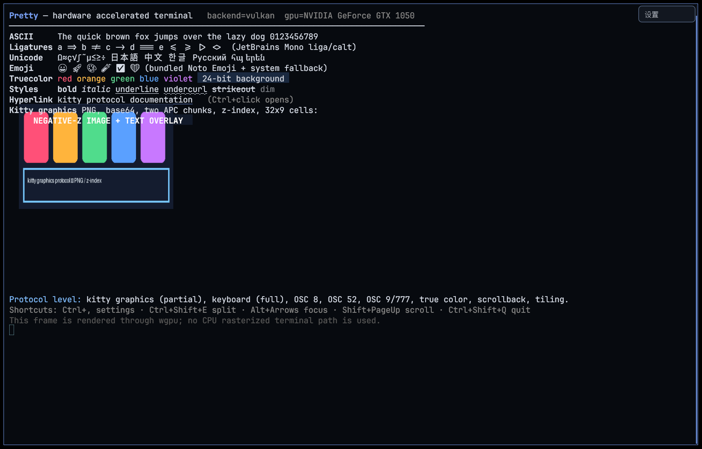

# Pretty

## **Warning**: Part of the code for this project was written by AI (Vibe coding).

Pretty is a hardware-accelerated terminal emulator written in Rust. It targets
the **kitty terminal protocol**, renders through **wgpu** with **Vulkan** or
**OpenGL ES 3.0+** on Linux, **Metal** on macOS and **Direct3D 12** on Windows,
and is designed to feel familiar to Konsole users: graphical settings,
tabs, find, configurable shortcuts, split panes, scrollback, native IME,
clipboard integration and desktop notifications.



## Status

| Area | State |
|---|---|
| Vulkan backend | **working**, tested on an NVIDIA GTX 1050 / driver 580.196.07 (580.178.04 in the earlier 0.1.0 evidence) |
| GLES backend | **working**, tested with a real OpenGL ES 3.2 NVIDIA context |
| Metal backend (macOS) | **implemented** — `--features metal`; `auto` prefers Metal on macOS. Built by CI on `macos-latest`; the GUI was not run on physical Mac hardware in this release |
| Direct3D 12 backend (Windows) | **implemented** — `--features dx`; `auto` prefers DX12 on Windows. Built by CI on `windows-latest`; the GUI was not run on physical Windows hardware in this release |
| kitty graphics | PNG/RGB/RGBA, chunked transfer, placement, delete, query, z-index; animation/file/SHM are not implemented |
| kitty keyboard | all five progressive-enhancement flags, query/push/pop, tested CSI-u output |
| Tabs / find / shortcuts | tab bar (top/bottom, separator/fade/powerline, alignment, minimum tabs, label templates, colours), full-scrollback find, GUI-editable key bindings, theme presets and kitty.conf import |
| Configuration freedom | kitty-level tab bar/cursor/mouse/scroll settings, live scrollback, pane borders, dim strength, reset-to-defaults; 21+ new keys documented in docs/CONFIG.md |
| Cursor blink | timer-thread driven + advanced on every presented frame, so rapid mouse input cannot starve it; verified with 60 fps capture |
| IME | native Wayland text-input-v3; X11 XIM fallback; per-app Fcitx state is preserved |
| Tiling, transparency, blur | working tiling panes; native KWin Wayland `ext_background_effect_v1` + X11 per-pixel ARGB alpha with real blur |
| Packages | deb, rpm and relocatable tar.gz on Linux (built and hash-verified for this pre-release); portable Windows zip and macOS `.app`/tar.gz from CI with desktop entry, icon, man page and terminfo. The Flatpak script is maintained but was not rebuilt for this pre-release (no `flatpak-builder` on the build host) |
| License | GPL-3.0-or-later; bundled fonts remain OFL-1.1 |

See [docs/KITTY-COMPAT.md](docs/KITTY-COMPAT.md) for the item-by-item protocol
matrix, [docs/TEST-REPORT.md](docs/TEST-REPORT.md) for real-hardware evidence and
[docs/KNOWN-ISSUES.md](docs/KNOWN-ISSUES.md) for honest limitations.

## Platform support

`auto` is platform-aware: Windows prefers Direct3D 12, macOS prefers Metal, and
Linux/FreeBSD/Android prefer Vulkan then OpenGL ES. The table separates what was
executed on real hardware from what was only compiled or CI-built.

| Platform | `auto` order | Evidence in this release | Native artifact |
|---|---|---|---|
| Linux / FreeBSD | Vulkan → GLES | built **and hardware-tested** on this host | Flatpak/deb/rpm/tar.gz from `scripts/build-packages.sh`; CI `ubuntu-latest` tar.gz |
| Windows 10/11 x86_64 | DX12 → Vulkan → GLES | `cargo check --target x86_64-pc-windows-gnu --features dx` locally (no MinGW linker) + CI build/test on `windows-latest` | `pretty-<ver>-windows-x86_64.zip` |
| macOS 11+ | Metal → Vulkan (MoltenVK) | `cargo check --target aarch64-apple-darwin --features metal` locally (no Apple linker) + CI build/test on `macos-latest` (arm64 on public GitHub runners) | `pretty-<ver>-macos-<arch>.app.tar.gz` / `.tar.gz` |
| Android arm64 | Vulkan → GLES | `cargo check --target aarch64-linux-android --features android` only; **no APK is claimed** | — (needs NDK, `android-activity` entry, storage and soft-keyboard work) |

"Implemented" means the backend is selected through wgpu and the full renderer
runs on it; it does not mean the GUI was executed on physical Windows or Mac
hardware for this release. Windows/macOS binaries are built by native GitHub
Actions runners (`.github/workflows/build.yml`), which also run the unit tests;
a GUI smoke test is not performed there (only `--version`/`--print-info`).


## Features

- GPU-rendered terminal grid, true 24-bit colour, bold/italic/dim, underline
  styles, strikeout, cursor shapes and selection.
- Text shaping with **JetBrains Mono ligatures** (`=>`, `!=`, `->`, `===`, …),
  configurable OpenType features and system-font fallback for CJK.
- Bundled monochrome Noto Emoji fallback and colour-font support in the atlas.
- **Kitty graphics protocol**: PNG and raw RGB/RGBA transfers, base64 chunks,
  transmit/display, placements, z-index, delete and query, with protocol
  responses. Images are clipped to their pane and move with scrollback.
- **Kitty keyboard protocol**: disambiguate, event types, alternate keys, all
  keys as CSI-u, associated text; progressive push/pop/query tested.
- OSC 8 hyperlinks rendered with an underline; Ctrl+click opens the URL.
- OSC 52 clipboard copy/paste (configurable), OSC 0/2 window titles, OSC 9 and
  OSC 777 desktop notifications.
- Full mouse reporting: X10, 1000, 1002, 1003, 1005 and 1006.
- Scrollback (default 10,000 lines), scrollbar, Shift+PageUp/PageDown and
  wheel scrolling; scroll regions and alternate screen from the terminal core.
- **Tiling panes** with real PTYs, keyboard focus navigation and per-pane
  terminals.
- **Touchscreen support**: tap to focus, drag to select and two-finger vertical
  swipes to scroll; touch is translated to mouse reports when an application
  enables mouse tracking.
- **Right-click context menu** with copy/paste, select all, clear, split/close
  pane, settings and quit. With application mouse reporting enabled, use
  Shift+right-click or the keyboard shortcuts.
- **File drop/paste**: drag files from Dolphin/other XDG drag sources or paste
  `file://` URIs; paths are shell-quoted before insertion.
- **English / 简体中文 UI** with automatic locale detection and a language
  selector in Settings; a system CJK font is used as the egui fallback.
- **Fcitx5 XIM input** on X11/XWayland, including IME cursor
  placement and an inline preedit overlay. On Plasma Wayland sessions Pretty
  fills in `XMODIFIERS` when Fcitx5 is running but the variable is unset.
- **Animated kitty images** (mpv `--vo=kitty`): opaque auto-id frames that repeat
  at the same anchor replace the previous frame, and all image/GPU caches are
  bounded and evicted. A long video no longer fills the 256-image table.
- Translucent window with **real KWin blur-behind** on KDE/X11. On X11 the
  background is rendered as per-pixel ARGB alpha, so KWin blurs the client
  buffer while terminal text stays fully opaque; no fake CPU blur and no
  whole-window opacity layer.
- A customisable egui settings panel (Ctrl+, or the Settings button) with tabs
  for General, Terminal, Appearance, **Tab bar**, Rendering, Keyboard and About,
  covering font, theme presets, the 16-colour ANSI palette, cursor
  shape/colour/opacity/text colour/blink, dim strength, pane borders, bell
  behaviour, wheel/scrollbar, pointer hiding, focus-follows-mouse,
  copy-on-select, confirm-close, OSC 52 policy, UI scale, tab bar (edge, style,
  alignment, minimum tabs, templates, colours), window size, remember-size,
  window decorations, opacity/blur/padding, scrollback, tiling gap, vsync and
  backend selection. It also has a **kitty.conf importer** and a two-click
  **Reset all settings**. Only a restart is required to change GPU backend.
  Every key is documented in [docs/CONFIG.md](docs/CONFIG.md).
- **HiDPI-correct UI.** Tab bar, settings, menus, context menu and IME cursor
  are laid out in logical points and converted exactly once; verified at scale
  factors 1.0/1.25/1.5/2.0 and with the extra `ui_scale` zoom.
- Startup logs include requested/resolved backend, GPU, driver, surface format,
  alpha mode, font and the compiled protocol-capability summary.

## UX notes

- Tabs: `Ctrl+Shift+T`, `Ctrl+Tab` / `Ctrl+Shift+Tab`, or the tab bar. The tab
  bar can be hidden and its height set in **Settings → Appearance**.
- Find: `Ctrl+Shift+F` or the tab-bar **Find** button; it searches the full
  scrollback and selects the current match. Closing Find returns keyboard input
  to the terminal, and while the Find box is focused the IME candidate window
  follows it instead of the terminal cursor.
- Shortcuts are editable under **Settings → Keyboard** and stored in the
  `[shortcuts]` table of the config. Clearing a binding disables that action,
  including the settings toggle itself; the context menu and tab-bar tooltips
  show the current bindings.
- Look and feel: **Settings → Appearance** has theme presets (Catppuccin Mocha,
  Dracula, Nord, Gruvbox Dark, Tokyo Night, Solarized Dark, One Dark), an
  editable ANSI palette, UI scale and tab-bar controls. Picking a preset fills
  only colour keys that are absent from the config file, so explicit colours
  always win.
- Terminal behaviour: cursor shape/colour/blink interval, visual or
  window-attention bell, copy-on-select, confirm-before-quit and separate
  OSC 52 copy/paste permissions live in **Settings → Terminal**.
- `kitty.conf` users can migrate with
  `pretty --import-kitty-conf ~/.config/kitty/kitty.conf` or the **Import
  kitty.conf** button in settings; unsupported kitty options are reported and
  never abort the import.
- A setting changed less than a debounce window before quitting is saved on
  exit; the previous `std::process::exit` path could lose the last edit.
- Native Wayland is preferred for Vulkan so Fcitx uses text-input-v3 (its normal
  compact candidate popup) and KWin blurs through `ext_background_effect_v1`.
  X11/XWayland remains the fallback; GLES still uses XWayland on this driver.
- Cursor blinking is controlled by `cursor_blink`; it intentionally overrides a
  terminal `DECSCUSR` steady style. The off phase draws a dim outline rather than
  making the cursor vanish entirely. A dedicated 16 ms timer thread (plus a
  phase advance on every presented frame) keeps the blink cadence stable even
  while the pointer is moving at high frequency — the previous
  `ControlFlow::WaitUntil`-only path starved under a mouse flood and could
  freeze the cursor in one phase.
- `tab_title_template` supports `{index}` (1-based), `{title}` and `{count}`;
  unknown placeholders are kept literally so typos are visible. The tab strip
  scrolls horizontally when tabs do not fit.

## Flatpak

A single-file Flatpak bundle is produced by:

```bash
cargo build --release -p pretty-app
cp target/release/pretty .portable-pretty   # optional; or pass PRETTY_FLATPAK_BIN
scripts/build-flatpak.sh
# dist/pretty-0.2.0-x86_64.flatpak
flatpak install --user ./dist/pretty-0.2.0-x86_64.flatpak
flatpak run io.github.mappingAu.Pretty
```

The app uses `org.freedesktop.Platform//25.08`, Wayland/X11 fallback, DRIs,
home access, network access and notifications. A Noto CJK face is bundled because the
freedesktop runtime does not ship one. The Flatpak build is a packaging-only
check; it was not installed or launched. It was **not rebuilt for the v0.2.0
pre-release** because `flatpak-builder` is unavailable on the release host.

## Build

Prerequisites on Fedora (Rust 1.89+ is required; the repository pins a stable
toolchain):

```bash
sudo dnf install rust cargo gcc gcc-c++ pkgconf-pkg-config \
  fontconfig-devel freetype-devel libxkbcommon-devel wayland-devel \
  mesa-libEGL-devel libX11-devel libxcb-devel vulkan-loader-devel \
  openssl-devel
cargo build --release
```

Using rustup (recommended for portable packaging and cross checks):

```bash
rustup toolchain install stable
rustup target add x86_64-pc-windows-gnu aarch64-apple-darwin \
  aarch64-linux-android
cargo build --release
```

The binary is `target/release/pretty`. Backend features are platform-specific:

```bash
# Linux (default): Vulkan + OpenGL ES
cargo build --release -p pretty-app

# Windows (native MSVC build, from Windows): Direct3D 12 + Vulkan/GLES fallback
cargo build --release -p pretty-app --features dx
# then: scripts/build-windows.sh   -> dist/pretty-<ver>-windows-x86_64.zip

# macOS (native build, from macOS): Metal + Vulkan (MoltenVK) fallback
cargo build --release -p pretty-app --features metal
# then: scripts/build-macos.sh     -> dist/pretty-<ver>-macos-<arch>.app.tar.gz

# Android: compile-only check, no APK is built
cargo check --target aarch64-linux-android -p pretty-app --features android
```

Windows and macOS binaries cannot be produced on the Linux development host used
for this release (no MinGW or Apple linker), so they are built and unit-tested
natively by `.github/workflows/build.yml` on `windows-latest` and
`macos-latest`. Local cross-target checks stay compile-only:

```bash
scripts/cross-check.sh   # target matrix, host feature matrix, docs/CROSS-COMPILE.md
```

The bundled terminfo is generated with:

```bash
tic -x -o ~/.terminfo packaging/pretty.terminfo
```

A relocatable tarball and native Linux packages are produced with:

```bash
scripts/build-packages.sh
```

## Run

```bash
./target/release/pretty                     # auto: platform-native backend first
./target/release/pretty --print-info        # compiled backends, auto order, adapters
PRETTY_RENDERER=vulkan ./target/release/pretty
PRETTY_RENDERER=gles   ./target/release/pretty

# Native backend of the Windows build:
pretty.exe --renderer dx
# Native backend of the macOS build:
./pretty --renderer metal
```

The selected backend can also be set in the config file. `PRETTY_RENDERER` and
`--renderer` take precedence. `auto` tries the platform-preferred order and
skips backends that were not compiled in; explicitly selecting an unavailable
backend fails with an explicit error (never a silent fallback to another API).
Pretty never falls back to a CPU rasteriser: if no hardware-compatible adapter
exists, startup fails with the exact reason for every candidate.

### GLES note

wgpu's GL backend prefers desktop OpenGL when EGL advertises it. The repository
vendors a small `wgpu-hal` patch (`vendor/wgpu-hal`) that makes the backend create
an **actual `EGL_OPENGL_ES_API` context** when Pretty requests GLES. This is why
the driver string in the logs is `OpenGL ES 3.2 ...`. Pretty validates that the
driver is a GLES/ANGLE context and refuses desktop GL. On Linux, GLES currently
uses an X11/XWayland window surface; native Wayland EGL presentation is not
usable with this NVIDIA driver. See `docs/RENDERER.md` and
`docs/KNOWN-ISSUES.md`.

## Hardware-only policy

Pretty refuses CPU/software adapters on normal startup. If no hardware adapter
for any compiled backend is available it prints the reason, exits non-zero and
does not silently fall back to a CPU rasterizer. `--allow-software` is a
testing-only escape hatch for packaging CI on machines without a GPU (for
example Xvfb and llvmpipe, or Windows' WARP software adapter). It is never
enabled by default, logs a prominent warning, and is not used for any GPU
rendering claim in this repository.

## Configuration

Configuration is TOML at `~/.config/pretty/config.toml` (or `$PRETTY_CONFIG`,
or `--config`). It can also be edited graphically; changes apply live and are
saved after a short debounce. Only CLI overrides such as `--opacity` or
`--no-blur` are runtime-only and are not persisted. Missing keys fall back to
defaults, so old config files keep working. The complete key reference,
theme-preset list and kitty.conf mapping table are in
[docs/CONFIG.md](docs/CONFIG.md).

```toml
renderer = "auto"          # auto | vulkan | gles | metal (macOS) | dx (Windows)
font_family = "JetBrains Mono"
font_size = 15.0
line_height = 1.18
ligatures = true
font_features = ["liga", "calt"]
opacity = 0.90
blur = true                # KWin blur-behind
padding = 10.0
gap = 5.0
theme = "pretty"           # preset, or "custom"; see docs/CONFIG.md
background = "#0d1117"
foreground = "#d8dee9"
cursor = "#88c0d0"
accent = "#7aa2f7"
selection_bg = "#334b67"
selection_fg = "#eceff4"
palette = []               # optional color0..color15 overrides
scrollback = 10000
vsync = true
shell = "/bin/bash"
allow_osc52_paste = false  # opt-in: applications may read the clipboard (OSC 52)
allow_osc52_copy = true    # applications may write the clipboard (OSC 52)
window_width = 1280
window_height = 820
language = "auto"          # auto | en | zh-CN
ui_accent = "#7aa2f7"
ui_panel_opacity = 1.0
ui_scale = 1.0             # zoom tab bar, menus, settings (0.6-2.5)
tab_bar_visible = true
tab_bar_height = 30.0
tab_bar_edge = "top"       # top | bottom
tab_bar_style = "separator" # separator | fade | powerline
tab_bar_align = "left"     # left | center | right
tab_bar_min_tabs = 1
tab_title_template = "{index}: {title}"
active_tab_title_template = ""   # empty = same as inactive tabs
tab_bar_background = ""    # empty = automatic theme colour
active_tab_background = ""
active_tab_foreground = ""
inactive_tab_background = ""
inactive_tab_foreground = ""
cursor_blink = true
cursor_blink_interval_ms = 530
cursor_opacity = 1.0
cursor_text_color = ""     # empty = terminal background
cursor_shape = "block"     # block | beam | underline
dim_opacity = 0.5
active_border_color = ""   # empty = accent
inactive_border_color = "" # empty = theme border
wheel_scroll_multiplier = 3.0
wheel_scroll_min_lines = 1
scrollbar = "scrolled"     # always | scrolled | never
mouse_hide_wait = 3.0      # 0 = never hide the pointer
focus_follows_mouse = false
remember_window_size = true
hide_window_decorations = false
bell = "attention"         # attention | visual | none
visual_bell_duration_ms = 120
copy_on_select = false
confirm_close = false
prefer_x11_for_blur = false  # retained for compatibility only
```

Prepare a migration from kitty with:

```bash
pretty --import-kitty-conf ~/.config/kitty/kitty.conf
# or Settings -> General -> Import kitty.conf
```

The importer understands the common font, colour, cursor, scrollback, padding,
opacity, bell, copy-on-select and `map` options, follows `include` (with globs
and cycle detection) and reports unsupported kitty options as warnings instead
of failing.

Blur/transparency: native Wayland Vulkan uses KWin's
`ext_background_effect_v1`; X11/XWayland uses a 32-bit ARGB client buffer with
per-pixel alpha and `_KDE_NWM_BLUR_BEHIND_REGION`. `prefer_x11_for_blur` is kept
for config compatibility, but the windowing path is now chosen by the renderer
(GLES uses XWayland on this driver; Vulkan stays on native Wayland).

## Keyboard shortcuts

Every action in this table is configurable (or can be unbound) in
**Settings → Keyboard** / the `[shortcuts]` table; the table shows the defaults.

| Shortcut | Action |
|---|---|
| Ctrl+, | Toggle graphical settings |
| Ctrl+Shift+E | Split focused pane to the right |
| Ctrl+Shift+O | Split focused pane down |
| Ctrl+Shift+W | Close focused pane |
| Alt+Arrow | Focus a neighbouring pane |
| Ctrl+Shift+C / Ctrl+Shift+V | Copy selection / paste |
| Shift+PageUp / Shift+PageDown | Scroll history by page |
| Ctrl+Shift+Up / Ctrl+Shift+Down | Scroll history by line |
| Ctrl+Shift+Plus / Minus / 0 | Increase / decrease / reset font size |
| Shift+Mouse | Local selection even when mouse reporting is active |
| Ctrl+Click on hyperlink | Open URL |
| Ctrl+Shift+Q | Quit |

## Testing

```bash
cargo test --workspace
scripts/test-hardware.sh      # needs a real KDE/X11 display, GPU, xdotool, xclip, vttest
scripts/qa-v020.sh            # GUI-free QA: core suites, workspace tests, CLI smoke
scripts/cross-check.sh        # Windows/macOS/Android compile checks + feature matrix
```

`.github/workflows/build.yml` runs the same unit tests and builds release
binaries natively on `ubuntu-latest`, `windows-latest` and `macos-latest`, then
uploads the packaged artifacts. It runs on every push to `master` and can be
started manually with **workflow_dispatch**; it does not create GitHub
releases. GUI tests are intentionally not part of CI — the runners have no
usable session/GPU for them.

The hardware script captures screenshots and logs under `test-artifacts/` and
copies the evidence used by `docs/TEST-REPORT.md` into `docs/screenshots/`.
`scripts/test-hardware.sh` is the canonical reproducible hardware test entry
point; it is not a mock.

## Packaging

`scripts/build-packages.sh` produces:

- `dist/pretty-terminal_0.2.0_amd64.deb`
- `dist/pretty-terminal-0.2.0-1.fc44.x86_64.rpm`
- `dist/pretty-0.2.0-linux-x86_64.tar.gz`

All contain the binary, desktop entry, icons, man page and `TERM=pretty` terminfo
entry. The deb/rpm packages install under `/usr`; the tarball is relocatable and
ships `install.sh`. Installation verification is documented in
[docs/PACKAGING.md](docs/PACKAGING.md).

Windows and macOS packages are cross-built natively by
`.github/workflows/build.yml` (the Linux development host has no MinGW/Apple
linker). They can also be produced on a native host with the wrapper scripts:

- `scripts/build-windows.sh` → `dist/pretty-<ver>-windows-x86_64.zip` (portable
  folder with `pretty.exe`, README, LICENSE, docs, icon); see
  [packaging/windows/README.md](packaging/windows/README.md);
- `scripts/build-macos.sh` → `dist/pretty-<ver>-macos-<arch>.app.tar.gz`
  (`Pretty.app` with `Info.plist` and generated `.icns`, ad-hoc signed) plus a
  standalone CLI tar.gz; see [packaging/macos/README.md](packaging/macos/README.md).

The same CI workflow also assembles `pretty-<ver>-linux-x86_64.tar.gz` from the
native Ubuntu build. All three platform artifacts are uploaded to the workflow
run (not to a GitHub release).

## Documentation

- [Architecture](docs/ARCHITECTURE.md)
- [Renderer abstraction](docs/RENDERER.md)
- [Kitty compatibility matrix](docs/KITTY-COMPAT.md)
- [Real-hardware test report](docs/TEST-REPORT.md)
- [Packaging and install verification](docs/PACKAGING.md)
- [Known issues](docs/KNOWN-ISSUES.md)
- [Cross-platform status and prerequisites](docs/CROSS-PLATFORM.md)
- [Cross-compile report](docs/CROSS-COMPILE.md)
- [v0.2.0 QA and test report](docs/TEST-REPORT-V0.2.0.md)
- [0.2.0 core/UX audit](docs/AUDIT-020.md)

## License

Pretty is licensed under **GNU General Public License v3.0 or later**
(`GPL-3.0-or-later`). See [LICENSE](LICENSE). Bundled JetBrains Mono and Noto
fonts are licensed under the SIL Open Font License 1.1; their license texts are
shipped in `assets/licenses/` and in installed packages.
