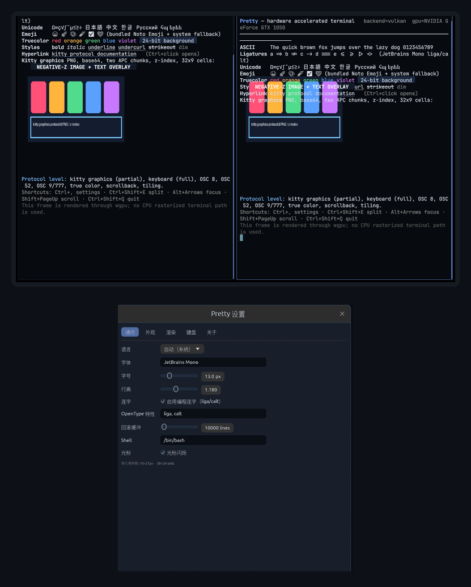

<div align="center">

# Pretty

**一个用惯 Konsole 也能直接上手的 GPU 终端，自带 kitty 的全部能力。**

Rust · `wgpu` · 全平台 Vulkan（macOS 用 Metal、Windows 用 Direct3D 12）· GPL-3.0

[**下载 v0.2.4**](https://github.com/mappingAu/pretty/releases/tag/v0.2.4)
· [安装](#安装)
· [功能](#功能)
· [English](README.md)

</div>



## 为什么用 Pretty？

- **看得见、点得到的设置。** 字体、主题、光标、标签页、面板边框、透明度、快捷键都有图形化界面（Ctrl+,），不写配置文件也能用；同时支持一键导入 `kitty.conf`。
- **真正的 kitty 协议。** kitty graphics（PNG/RGB/RGBA、placement、z-index）让 `mpv --vo=kitty` 和图片预览直接可用；完整 kitty 键盘协议；OSC 8 超链接；OSC 52 剪贴板；桌面通知。
- **为 Linux 桌面而生。** 原生 Wayland text-input-v3（Fcitx5 候选框位置正确）、KWin 真实磨砂背景、X11 逐像素 ARGB 透明、HiDPI 布局精确、中英双语界面。
- **平铺分屏与标签页**，每个面板都是真实 PTY，支持键盘切换焦点、全回滚缓冲区搜索、自定义快捷键。
- **工程上不糊弄。** 统一走 wgpu，后端选择失败时给出明确错误，绝不静默回退到 CPU 渲染；硬件测试报告都在 `docs/` 里。

> **说明：** 部分代码由 AI 辅助完成（vibe coding）。每个版本都有单元测试，Linux 版本在真实硬件上验证；Windows/macOS 二进制由原生 CI 构建并跑单元测试。

## 安装

所有平台的预编译包都在
[**v0.2.4**](https://github.com/mappingAu/pretty/releases/tag/v0.2.4)：

| 平台 | 文件 | 安装方式 |
|---|---|---|
| Fedora / RHEL / openSUSE（RPM） | `pretty-terminal-0.2.4-1.x86_64.rpm` | `sudo dnf install ./pretty-terminal-0.2.4-1.x86_64.rpm`（或 `zypper install`） |
| Debian / Ubuntu | `pretty-terminal_0.2.4_amd64.deb` | `sudo apt install ./pretty-terminal_0.2.4_amd64.deb` |
| 任意 Linux | `pretty-0.2.4-linux-x86_64.tar.gz` | 解压后执行 `./install.sh`，或直接运行 `./bin/pretty` |
| Windows 10/11 | `pretty-0.2.4-windows-x86_64.zip` | 解压后运行 `pretty.exe`（Direct3D 12 或 Vulkan） |
| macOS 11+（arm64） | `pretty-0.2.4-macos-arm64.app.tar.gz` | 解压后把 `Pretty.app` 拖入「应用程序」 |

需要支持 Vulkan 的显卡；Pretty 不会回退到 CPU 渲染。从源码构建：

```bash
cargo build --release -p pretty-app    # Linux：Vulkan + OpenGL ES
./target/release/pretty
```

## 功能

- GPU 渲染终端网格，24 位真彩色、粗体/斜体/暗淡、下划线样式、删除线、光标形状与选区。
- JetBrains Mono 连字（`=>`、`!=`、`->`、`===`……）、可配置 OpenType 特性、CJK 系统字体回退、Noto Emoji。
- **kitty 图形协议**：PNG 与原始 RGB/RGBA、base64 分块、放置/删除/查询、z-index，图像裁剪在面板内并随回滚滚动。
- **kitty 键盘协议**：全部五个渐进增强标志、query/push/pop。
- OSC 8 超链接（Ctrl+点击打开）、OSC 52 剪贴板（可限制权限）、OSC 9/777 桌面通知、X10 到 1006 全部鼠标模式。
- **平铺分屏**（Ctrl+Shift+E 左右分屏、Ctrl+Shift+O 上下分屏、Alt+方向键切换）、**标签页**（Ctrl+Shift+T，可调位置/样式/对齐/标签模板）。
- **全回滚缓冲区搜索**（Ctrl+Shift+F）。
- 触摸屏：点击聚焦、拖动选择、双指滑动滚动。
- 右键上下文菜单：复制/粘贴、全选、清屏、分屏、设置、退出。
- 文件拖放与 `file://` 粘贴，路径自动做 shell 转义。
- **中英文界面**，自动识别系统语言。
- **Fcitx5 输入法**：原生 Wayland text-input-v3，X11 XIM 回退；Plasma Wayland 下自动补齐 `XMODIFIERS`。
- **KWin 真实磨砂背景**：X11 逐像素 ARGB 透明 + `_KDE_NET_WM_BLUR_BEHIND_REGION`，文字保持完全不透明；Wayland 使用 `ext_background_effect_v1`。
- 可自定义的 16 色 ANSI 调色板、主题预设（Catppuccin、Dracula、Nord、Gruvbox、Tokyo Night、Solarized、One Dark）、光标透明度与文字颜色、面板边框颜色、滚动条策略、鼠标空闲隐藏、跟随鼠标聚焦等。

完整功能说明与截图见英文 [README](README.md)，全部截图见
[docs/screenshots/](docs/screenshots/)，协议兼容矩阵见
[docs/KITTY-COMPAT.md](docs/KITTY-COMPAT.md)，全部配置项见
[docs/CONFIG.md](docs/CONFIG.md)。

## 常用快捷键

| 快捷键 | 功能 |
|---|---|
| Ctrl+, | 打开/关闭图形化设置 |
| Ctrl+Shift+T | 新建标签页 |
| Ctrl+Shift+E / Ctrl+Shift+O | 左右 / 上下分屏 |
| Ctrl+Shift+W | 关闭当前面板 |
| Alt+方向键 | 切换到相邻面板 |
| Ctrl+Shift+C / Ctrl+Shift+V | 复制 / 粘贴 |
| Ctrl+Shift+F | 搜索回滚内容 |
| Shift+PageUp / PageDown | 按页滚动历史 |
| Ctrl+Shift+Q | 退出 |

所有快捷键都可以在 **设置 → 键盘** 中修改或解绑。

## 从 kitty 迁移

```bash
pretty --import-kitty-conf ~/.config/kitty/kitty.conf
```

也能在 **设置 → 通用 → 导入 kitty.conf** 中完成。常用字体、颜色、光标、回滚、内边距、透明度、响铃、复制选项和 `map` 会被识别，不支持的选项会以警告列出而不会中断导入。

## 反馈与贡献

- 遇到问题或有需求，欢迎 [提交 Issue](https://github.com/mappingAu/pretty/issues)，请附上系统、显卡/驱动信息（`pretty --print-info` 的输出）以及日志。已知问题见
  [docs/KNOWN-ISSUES.md](docs/KNOWN-ISSUES.md)。
- 提交 PR 前请运行 `cargo test --workspace` 与 `cargo build --release -p pretty-app`。

## 许可

Pretty 以 **GNU General Public License v3.0 or later**（`GPL-3.0-or-later`）发布，详见 [LICENSE](LICENSE)。内置的 JetBrains Mono 与 Noto 字体遵循 SIL Open Font License 1.1。
