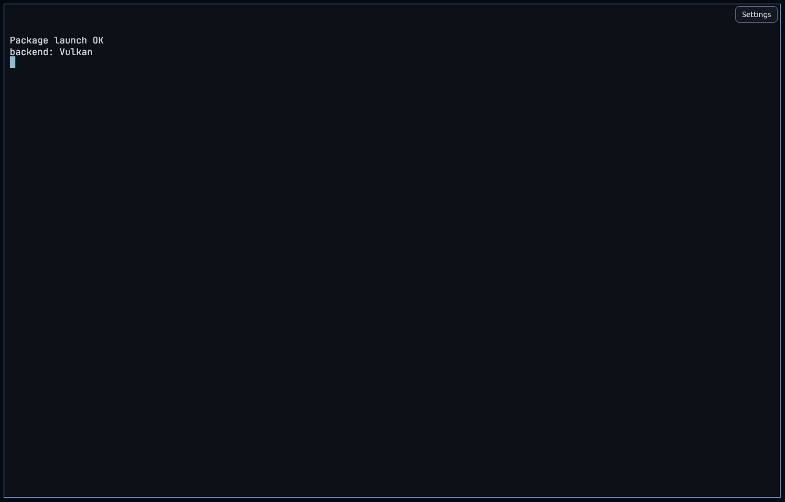
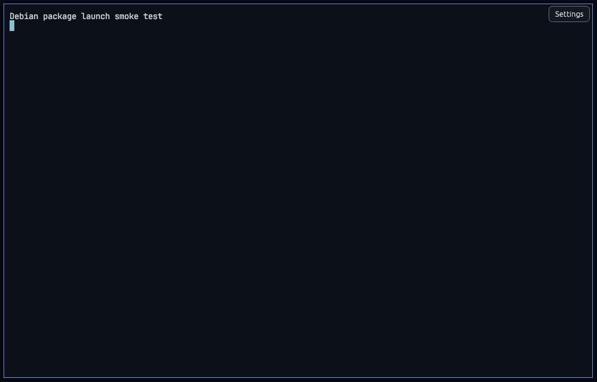

# Packaging and installation verification

`scripts/build-packages.sh` builds three installable artifacts from one staged
tree:

- `dist/pretty-terminal_0.1.0_amd64.deb`
- `dist/pretty-terminal-0.1.0-1.fc44.x86_64.rpm`
- `dist/pretty-0.1.0-linux-x86_64.tar.gz`

Every artifact carries the `pretty` binary, desktop entry, scalable + PNG icons,
man page, the `pretty` terminfo entry, documentation and bundled font licenses.
The deb and rpm install under `/usr`; the tarball is relocatable and includes
`install.sh` and a direct `bin/pretty` launcher layout.

## Reproducible Debian-compatible binary

Building on Fedora links against glibc 2.43, which makes the deb uninstallable on
Debian 12 (glibc 2.36). For the delivered deb, the binary is therefore built in a
Debian 12 container using the official rustup toolchain and the container's older
glibc:

```bash
podman run --rm --security-opt label=disable \
  -v "$PWD:/src:Z" -v "$HOME/.cargo:/cargo:Z" -v "$HOME/.rustup:/rustup:Z" \
  -v "$HOME/.cache/pretty-portable/target:/target:Z" \
  -e CARGO_HOME=/cargo -e RUSTUP_HOME=/rustup -e CARGO_TARGET_DIR=/target \
  -e CARGO_NET_OFFLINE=true \
  -e PATH=/cargo/bin:/usr/local/sbin:/usr/local/bin:/usr/sbin:/usr/bin:/sbin:/bin \
  docker.io/library/debian:bookworm-slim /bin/bash -c '
    apt-get update && apt-get install -y --no-install-recommends \
      gcc g++ pkg-config make ca-certificates libxkbcommon-dev libwayland-dev \
      libx11-dev libxcb1-dev libegl1-mesa-dev libfontconfig1-dev \
      libfreetype-dev libvulkan-dev &&
    cd /src && cargo build --release -p pretty-app &&
    strip --strip-unneeded /target/release/pretty &&
    cp /target/release/pretty /src/.portable-pretty'
```

Use a target directory **outside** `build/` (for example
`/home/$USER/.cache/pretty-portable/target`), because `build-packages.sh`
cleans `build/` before staging. Then:

```bash
PRETTY_PACKAGE_BINARY="$PWD/.portable-pretty" scripts/build-packages.sh
```

The resulting binary's maximum symbol version is GLIBC 2.35 (verified with
`objdump -T .portable-pretty | grep -o 'GLIBC_[0-9.]*' | sort -Vu | tail`),
which runs on Debian 12 (glibc 2.36) and Ubuntu 22.04+ (glibc 2.35).

## Package contents

```
/usr/bin/pretty
/usr/share/applications/pretty.desktop
/usr/share/icons/hicolor/{scalable,16x16,24x24,32x32,48x48,64x64,128x128,256x256,512x512}/apps/
/usr/share/man/man1/pretty.1.gz
/usr/share/terminfo/p/pretty
/usr/share/doc/pretty/{README,KITTY-COMPAT,TEST-REPORT,RENDERER,ARCHITECTURE,KNOWN-ISSUES,PACKAGING}.md
/usr/share/doc/pretty/licenses/
```

The tar layout is:

```
pretty-0.1.0-linux-x86_64/
  bin/pretty
  share/... (same data files)
  docs/...
  install.sh
  README.txt
```

`bin/pretty` discovers `../share/terminfo/p/pretty` at startup when installed
relocatably, so a direct run has a working `TERM=pretty` entry without system
installation.

### Results (relocatable tarball)

| Check | Result | Evidence |
|---|---|---|
| extract into clean directory | PASS | `tar-root/` |
| `bin/pretty --version` | PASS — `pretty 0.1.0` | `tar-version.txt` |
| launch direct from extracted tree on the NVIDIA GPU | PASS — non-blank 369-colour screenshot | `docs/screenshots/package-tar.png` |
| bundled terminfo discovered at `../share/terminfo` | PASS | `tar-installed.log` |
| desktop file and 256×256 icon shipped | PASS | `tar-root/` |



## Final verification summary

`scripts/verify-packages.sh` finished with **0 failures** on the artifacts in
`dist/` (the exact timestamp is in the latest `test-artifacts/packaging-*/summary.txt`).
It verifies `dist/SHA256SUMS` first, installs the RPM, launches the installed
RPM, extracts and launches the tarball, then installs and launches the deb in a
clean Debian 12 container. Raw logs and screenshots are retained under
`test-artifacts/packaging-*/`.

## Host installation verification (Fedora 44 / KDE X11)

The following commands are run by the acceptance test and their real output is
kept in `test-artifacts/packaging-*/`:

```bash
sudo dnf install -y dist/pretty-terminal-0.1.0-1.fc44.x86_64.rpm
rpm -q pretty-terminal
rpm -ql pretty-terminal
pretty --version
infocmp -A /usr/share/terminfo pretty >/dev/null
test -f /usr/share/applications/pretty.desktop
test -f /usr/share/icons/hicolor/256x256/apps/pretty.png
man -w pretty
# launch installed binary on the real GPU and capture a screenshot
```

### Results (Fedora 44, KDE/X11, NVIDIA GTX 1050)

| Check | Result | Evidence |
|---|---|---|
| `sudo dnf install` RPM | PASS | `rpm-install.log` |
| `rpm -q pretty-terminal` | PASS — `pretty-terminal-0.1.0-1.fc44.x86_64` | `rpm-query.txt` |
| RPM contains binary, terminfo, desktop, icon, man page | PASS | `rpm-files.txt` |
| `/usr/bin/pretty --version` | PASS — `pretty 0.1.0` | `rpm-version.txt` |
| System terminfo (`infocmp -A /usr/share/terminfo pretty`) | PASS | `rpm-terminfo.txt` |
| Installed binary opens a real window on the NVIDIA GPU | PASS — non-blank 369-colour screenshot | `docs/screenshots/package-rpm.png` |


The installed RPM reports `GPU: renderer=vulkan ... adapter="NVIDIA GeForce GTX
1050"` in its log (`rpm-installed.log`).

## Debian 12 container installation verification

```bash
podman run --rm -it \
  -v "$PWD/dist:/dist:Z" \
  docker.io/library/debian:bookworm-slim /bin/bash
# inside:
apt-get update
apt-get install -y /dist/pretty-terminal_0.1.0_amd64.deb
pretty --version
infocmp pretty >/dev/null
```

The package's dependencies are resolved by apt. A GUI launch test runs under
Xvfb with Mesa's software GLES in the container purely to validate that the
installed package starts; the hardware-accelerated rendering evidence is on the
host NVIDIA GPU (see TEST-REPORT.md). This distinction is explicit and not
presented as GPU testing.

### Results (clean `debian:bookworm-slim`)

| Check | Result | Evidence |
|---|---|---|
| apt install of the local deb in a clean container | PASS | `deb-verify.log` |
| `dpkg-query` state | PASS — `install ok installed 0.1.0` | `deb-verify.log` |
| `pretty --version`, terminfo, desktop, icon | PASS | `deb-verify.log` |
| GUI launch under Xvfb 1280×820 | PASS — non-blank 371-colour screenshot | `docs/screenshots/package-deb.png` |
| Software-adapter disclosure | PASS — the only network/GPU-less smoke run uses `--allow-software` plus an explicit warning in `deb-gui.log`; never a default | `test-artifacts/packaging-*/` |



The Xvfb smoke test uses Mesa llvmpipe because the container has no GPU. It is
packaging validation only and is explicitly not used as hardware-rendering
evidence; the Vulkan/GLES hardware results are in `TEST-REPORT.md`.

## RPM notes

The RPM is built with `rpmbuild` from a staged tarball and explicitly Requires
the dynamically loaded/EGL/Vulkan/X11 libraries. Fedora package names are used;
the spec is in `packaging/rpm/pretty-terminal.spec`.

## Verification script

`scripts/verify-packages.sh` performs:
1. artifact existence and checksum validation;
2. RPM install, file-list, version, terminfo, desktop/icon/man checks, and an
   installed-binary GUI screenshot on the host GPU;
3. tar extraction in a clean directory and a direct `bin/pretty` launch;
4. Debian container installation and GUI launch under Xvfb;
5. logging every command/status into `test-artifacts/packaging-<stamp>/`.
