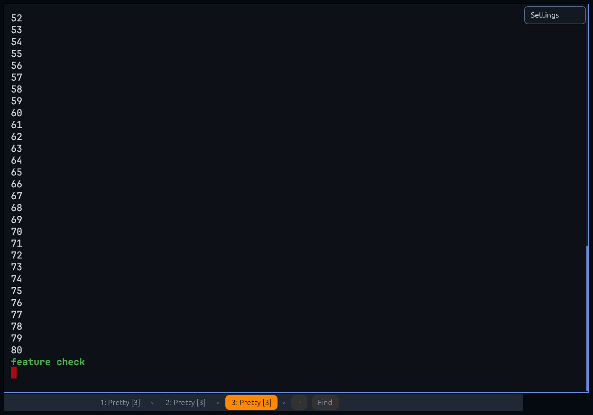
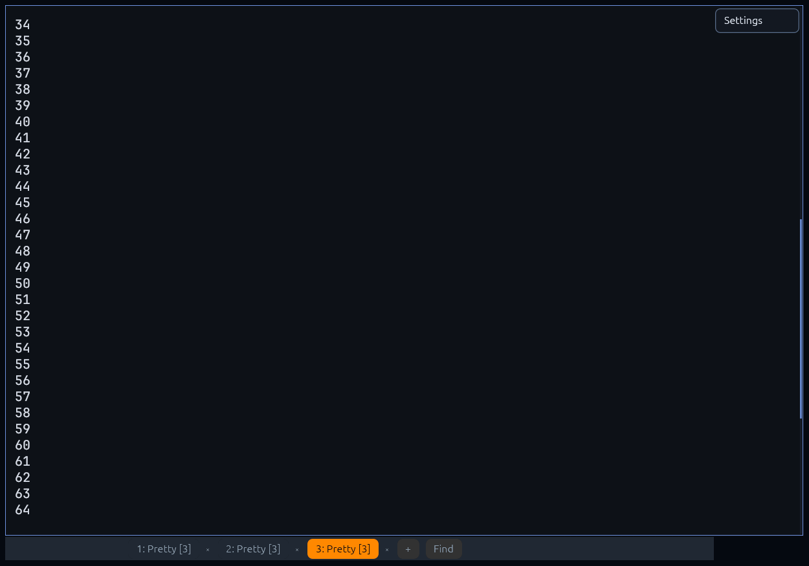

# Pretty v0.2.0 pre-release QA / test report

**Run:** QA pass for the v0.2.0 pre-release
**Date:** 2026-11-10 (Asia/Shanghai)
**Repository:** `/home/mapping/文档/deepseek-harness/default-workspace/pretty`
**Base commit:** `e540a2af3804cd55b19ded3edae931a8ad4287a5`
(`chore(release): bump version to 0.2.0 and refresh documentation`)
**Worktree state:** uncommitted changes from three concurrent owners
(`pretty-app`, `pretty-renderer`, `pretty-core`). This report covers the
`pretty-core` changes in this pass; app/renderer findings were read-only.

## 1. Scope and method

This QA pass covered:

1. Reading `README.md`, `docs/TEST-REPORT.md`, `docs/AUDIT-020.md`,
   `docs/KNOWN-ISSUES.md`, `docs/KITTY-COMPAT.md` and `docs/CONFIG.md`.
2. A source audit of `pretty-core` (terminal state, stream/OSC/APC filtering,
   kitty graphics/keyboard, input encoding, PTY handling, frame/selection APIs)
   for real defects: overflow, panics, unbounded memory/CPU, wrong protocol
   behaviour, UTF-8/grapheme handling, selection/search edge cases, OSC 52
   policy and notification handling.
3. A read-only review of `pretty-app` and `pretty-renderer`; findings are
   reported with an owner but **no app/renderer file was edited**.
4. Running the existing Rust test suites and the CLI (no GUI window was opened;
   the graphical display is in use by another agent).
5. New regression tests for every fixed defect, and a reproducible QA script
   (`scripts/qa-v020.sh`).
6. Reviewing `docs/KNOWN-ISSUES.md` for stale claims (corrections are listed in
   section 8; that file was not edited).

**Not done:** GUI rendering, GPU driver interaction, IME, compositor blur,
packages and cross-platform builds. See section 9.

## 2. Environment

| Item | Value |
|---|---|
| OS | Fedora Linux 45 (`VERSION="45 (Forty Five)"`), x86_64 |
| Kernel | `7.2.15-300.fc45.x86_64` |
| CPU / RAM | 4 cores / 7.7 GiB |
| GPU | NVIDIA GeForce GTX 1050 |
| GPU driver | NVIDIA 580.196.07 (Vulkan probe, this run); docs record 580.178.04 from the earlier hardware run |
| Vulkan | adapter `NVIDIA GeForce GTX 1050`; llvmpipe (Mesa 26.2.6) also visible |
| GLES | `OpenGL ES 3.2 NVIDIA 580.196.07` |
| Session | KDE Plasma, Wayland (`XDG_SESSION_TYPE=wayland`, `WAYLAND_DISPLAY=wayland-1`, `DISPLAY=:0`) |
| Rust | rustc/cargo 1.99.1 (Fedora 1.99.1-2.fc45) |
| Clippy / rustfmt | **not installed** (`cargo-clippy` and `cargo-fmt` components are missing; no rustup component was added) |
| GUI | **not launched by this QA pass** (display in use by another agent) |
| Cargo build contention | another agent was rebuilding `pretty-app` / `pretty-renderer` during this run; several commands waited on the target-dir lock |

Artifacts: `test-artifacts/qa-v020-20261110-230721/`.

## 3. Test results

### 3.1 Rust test suites

| Check | Command | Exit | Result | Evidence |
|---|---|---|---|---|
| Baseline core (unpatched HEAD) | `cargo test -p pretty-core` | 0 | **PASS** — 54 unit + 9 `audit_020` (matches `docs/AUDIT-020.md`) | session output; counts documented in AUDIT-020 |
| Core, fixed (debug) | `cargo test -p pretty-core` | 0 | **PASS** — 61 unit + 9 `audit_020` + 4 `qa_v020` + 2 `pty_smoke` (+1 ignored stress test) | `final-core-debug.log` |
| New regression tests on **unpatched HEAD** | `cargo test -p pretty-core --test qa_v020` | 101 | **FAIL (expected)** — 4/4 failed; proves the tests guard the fixes | `prefix-verification-qa-v020.log` |
| New keyboard/stream tests on **unpatched HEAD** (temporary probe) | `cargo test -p pretty-core --test qa_prefix_probe` | 101 | **FAIL (expected)** — 5/5 failed | `prefix-verification.log` |
| PTY deadlock stress test (fixed) | `cargo test -p pretty-core --test pty_smoke -- --ignored` | 0 | **PASS** — channel filled (1024 chunks), `PtySession::drop` completed | `pty-deadlock-stress-fixed.log` |
| PTY deadlock stress test on **unpatched HEAD** | same, with the blocking-send reader temporarily restored | 101 | **FAIL (expected)** — `PtySession::drop deadlocked ...`, 5.04 s timeout | `pty-deadlock-stress-prefix.log` |
| Title-reset test on **unpatched HEAD** | `cargo test -p pretty-core set_scrollback_does_not_reset_the_window_title` (suppression disabled) | 101 | **FAIL (expected)** — title event `[ResetTitle]` | `title-reset-prefix.log` |
| Core, fixed (release) | `cargo test -p pretty-core --release` | 0 | **PASS** — 61 unit + 9 `audit_020` + 4 `qa_v020` + 2 `pty_smoke` (+1 ignored) | `cargo-test-core-release-final.log` |
| Workspace, debug | `cargo test --workspace` | 0 | **PASS** — 41 app + 61 core + 9 `audit_020` + 4 `qa_v020` + 2 `pty_smoke` (+1 ignored) + 15 renderer | `cargo-test-workspace-final.log` |
| Clippy | `cargo clippy --workspace --all-targets -- -D warnings` | — | **NOT RUN** — component not installed | `cargo clippy --version` reports `'cargo-clippy' is not installed` |
| rustfmt | `cargo fmt -p pretty-core -- --check` | — | **NOT RUN** — component not installed | `cargo-fmt` missing for the stable toolchain |
| QA script (GUI-free) | `scripts/qa-v020.sh --core-only` | 0 | **PASS** — `PASS=27 FAIL=0 SKIP=1` (1 skip = clippy) | `test-artifacts/qa-v020-20261110-235000/summary.txt` |

The four `qa_v020` tests failed on unpatched HEAD as follows (exact messages):

```
select_all_includes_scrollback_history
  select all must include the oldest scrollback line; got first line Some("line27")
selection_text_does_not_insert_spaces_for_wide_spacers
  left: "中 a"   right: "中a"
selection_text_has_no_leading_blank_lines
  left: "\n\nx"  right: "x"
graphics_error_response_is_bounded
  error response echoed attacker-controlled data: 262187 bytes
```

The temporary public-API probe also failed on HEAD for:

```
kitty_disambiguate_c0             left: ESC[13;1u        right: 0x0d
legacy_c0_combinations            left: 0x7f             right: 0x08 (ctrl+Backspace)
kitty_shifted_unshifted_code      left: ESC[65:65:97;2u  right: ESC[97:65;2u
kitty_event_types_alone_text      left: ESC[97;1:1u      right: "a"
oversized_apc_terminator_split    left: []               right: "visible"
```

Two further fixes were verified with a temporary re-introduction of the old
behaviour (the fixed source was restored byte-for-byte afterwards):

- **PTY deadlock (QA-7):** with the blocking `channel::send` reader restored,
  `PtySession::drop deadlocked while the reader channel was full` failed after
  the 5 s deadline (exit 101). With the fix it completes immediately.
- **Title reset (QA-6):** with `set_suppress_title` disabled, the test received
  `[ResetTitle]` and failed (exit 101); with the fix it passes.

### 3.2 CLI / UX smoke tests (no GUI)

Binary used by the recorded script run: `target/release/pretty`, mtime
2026-11-10 23:47:56 (28,547,384 bytes, sha256
`9a48570da7ed74a823c0117b82efd744c87f514fe7605a17b67a3f9a214bb936`), rebuilt
by another agent while this QA pass was running. App/config owners were still
editing concurrently, so the CLI checks are valid for the CLI/import/config
paths observed at that time, not a frozen release artifact. No GUI launch was
attempted. (An earlier manual run at 23:33 used the 23:18 binary and produced
the same CLI outcomes; its logs are in `cli-manual/`.)

| Check | Command (abridged) | Exit | Result | Evidence |
|---|---|---|---|---|
| Version | `pretty --version` | 0 | **PASS** — prints `pretty 0.2.0` | `cli-manual/version.out` |
| Help | `pretty --help` | 0 | **PASS** — usage printed (24 lines) | `cli-manual/help.out` |
| Unknown argument | `pretty --definitely-not-an-option` | 1 | **PASS** — `pretty: unknown argument ...` + usage | `cli-manual/unknown.err` |
| Print diagnostics | `pretty --print-info` | 0 | **PASS** — Vulkan + GLES adapters, auto order `vulkan,gles`, 0.2.0 | `cli-manual/print-info.out` |
| kitty.conf import | `pretty --import-kitty-conf kitty.conf --config cfg.toml` | 0 | **PASS** — `6 option(s) imported, 1 unsupported key(s), 1 warning(s)` in the script run (the 23:18 binary reported 5/2/2 for the same file; the importer changed concurrently); font_size/cursor_shape/background/color5/map applied | `test-artifacts/qa-v020-20261110-235000/cli-import-kitty-conf.log` |
| Missing include | import a file whose `include` is absent | 0 | **PASS (documented non-fatal)** — warning `cannot read ...; No such file`, other options still imported, target config preserved | `cli-manual/import-missing.err` |
| Missing import source | `pretty --import-kitty-conf /nonexistent ...` | 1 | **PASS** — `failed to import ...: cannot read ...` | `cli-manual/import-missing.err` |
| Malformed TOML | `RUST_LOG=info pretty --config bad.toml --print-info` | 0 | **PASS** — logs `failed to parse ...; using defaults`, continues, file byte-identical | `cli-manual/print-info-malformed.*` |

Additional CLI observations (reported, not fixed):

- `pretty --help` omits `--import-kitty-conf` and `--allow-software`, both of
  which are accepted options.
- An invalid `--renderer` value (e.g. `--renderer bogus`) is logged and then
  silently falls back to `auto` (`main.rs:357-363`), which is weaker than the
  README's "explicitly selecting an unavailable backend fails with an explicit
  error". An *unavailable but valid* backend is handled elsewhere; this is only
  the invalid-string path (not executed, because it would open a GUI).
- A failed `--import-kitty-conf` with a missing source creates a default config
  at the target path (`import_kitty_conf_to_file` calls `load(target)` first,
  which writes defaults on `NotFound`). It does not destroy an existing file,
  but the side effect is surprising.

## 4. Fixed in `pretty-core` (this pass)

All fixes are covered by new tests that failed on unpatched HEAD (section 3.1).
The only public API behaviour change is `Terminal::select_all` (it now selects
the full scrollback; the signature is unchanged). One additive API was added
(`PtySession::try_wait` / `PtyExitStatus`).

### QA-1 (High, security/DoS) — Unbounded kitty-graphics error echo to the PTY

**Files:** `crates/pretty-core/src/graphics.rs` (`error`, `snippet`,
`parse_control`, `parse_u32`, `parse_i32`).

**Root cause.** Error strings for malformed graphics control sections embedded
the complete attacker-controlled value, e.g.
`format!("invalid numeric value for {key}: '{value}'")`. `GraphicsStore::error`
then formatted the whole message into an `EINVAL:` response that
`Terminal::advance` sends as `TerminalEvent::PtyWrite`; `pretty-app` writes that
to the PTY **on the UI thread**. An APC is allowed to be 64 MiB, so a single
`a=t,i=<64 MiB of digits>` command produced a ~64 MiB response (and log line).
A client that does not drain its input blocks the UI; repeated commands cause
large transient allocations. Control characters were already replaced, so this
is not escape injection, but it is an untrusted-output resource amplifier.

**Fix.** Control values are shortened to 48 chars for error messages
(`snippet()`), and `error()` caps the sanitised message at 160 chars plus
`...`. Responses are now < ~200 bytes. `q=2` still suppresses errors entirely,
`q=1` still reports them.

**Test.** `crates/pretty-core/tests/qa_v020.rs::graphics_error_response_is_bounded`
(261,187-byte response before the fix; ≤ 512 bytes after).

**Reproduce (pre-fix):**
```rust
let mut s = GraphicsStore::new();
let r = s.handle(format!("a=t,i={}", "9".repeat(256 * 1024)).as_bytes(), 0, 0);
assert!(r.response.unwrap().len() < 512); // failed with 262187
```

### QA-2 (Medium) — `Terminal::select_all` copied only the visible viewport

**Files:** `crates/pretty-core/src/terminal.rs` (`select_all`).

**Root cause.** The selection top endpoint was `Line(-display_offset)` instead
of the grid's topmost line. With scrollback history present, everything above
the viewport was silently excluded from "Select all" / copy. On a 30-line
scrollback test the first copied line was `line27` instead of `line00`.

**Fix.** Select from `grid.topmost_line()` to `grid.bottommost_line()`; the
selection is independent of the current scroll position.

**Test.** `tests/qa_v020.rs::select_all_includes_scrollback_history`.

**Reproduce:** run 30 lines in a 20×4 terminal, press Select all (context menu or
`Ctrl+Shift+A`), copy: before the fix only the last four lines were copied.

### QA-3 (Low, data corruption) — `Frame::selection_text_from_cells` inserted spaces after wide characters and leading blank lines

**Files:** `crates/pretty-core/src/frame.rs` (`selection_text_from_cells`).

**Root cause.** Two independent bugs in the cell-based selection fallback:
1. every `wide_spacer` cell (second half of a CJK/emoji character) appended a
   literal space, so selecting `中a` produced `"中 a"`;
2. every unselected row (including rows before the selection) contributed an
   empty line, and only *trailing* whitespace was trimmed, so a selection that
   started on row 2 produced `"\n\nx"`.

**Fix.** Skip wide-spacer cells (the leading cell carries the whole character)
and trim empty rows at the start and end before joining with `\n`.

**Tests.** `selection_text_does_not_insert_spaces_for_wide_spacers`,
`selection_text_has_no_leading_blank_lines`.

**Note.** `pretty-app` currently copies with alacritty's
`Terminal::selection_text` (`selection_to_string`), so desktop copy was not
affected by this particular API bug; it is a public core API used by frame
consumers and was fixed for correctness.

### QA-4 (Low, parser recovery) — Oversized APC lost an `ESC \` terminator split across PTY reads

**Files:** `crates/pretty-core/src/stream.rs` (`feed_apc`).

**Root cause.** When an APC exceeded `MAX_APC` (64 MiB), the payload was
discarded and `ignore_prev_esc` was reset to false. If the discarded tail ended
with the ESC half of the `ESC \` terminator, the continuation backslash in the
next PTY read was not recognised: the filter stayed in `Mode::Ignore` and
swallowed all following output until an unrelated `BEL` appeared.

**Fix.** Remember whether the discarded payload ended with `0x1b` and seed
`ignore_prev_esc` from it.

**Tests.** `stream::tests::oversized_apc_recognises_terminator_split_across_reads`
(fails on HEAD: following `visible` was dropped) and
`oversized_apc_without_split_terminator_still_discards` (guards against ending
discard mode early on an unrelated backslash).

**Reproduce (pre-fix):** feed `ESC _ G` + 64 MiB + 16 bytes + `ESC`, then feed
`"\\visible"`; the second read produced no bytes.

### QA-5 (Medium, kitty keyboard protocol) — wrong key codes and legacy exceptions

**Files:** `crates/pretty-core/src/input.rs` (`encode_key`, `encode_kitty`,
`encode_legacy_c0`, `encode_legacy_named`).

**Root causes (four related defects):**

1. **Unshifted key code.** kitty requires the `unicode-key-code` to be the
   unshifted key ("the codepoint used is always the lower-case (or more
   technically, un-shifted) version of the key. It *must not* be `CSI 65`").
   Pretty used winit's logical (shifted) character, so Shift+A was
   `ESC[65:65:97;2u` instead of `ESC[97:65;2u`. With report-alternate-keys, the
   shifted field was also set equal to the key instead of the shifted character.
2. **Disambiguate exceptions.** kitty explicitly keeps `Enter`, `Tab` and
   `Backspace` on their legacy C0 bytes (so a shell can still be reset after a
   crashed application) unless report-all-keys is active. Pretty emitted
   `CSI 13;1u`, `CSI 9;1u` and `CSI 127;1u` for them with flag 1.
3. **Event types alone.** Report-event-types (flag 2) does not enable
   report-all-keys: text keys stay UTF-8 and have no release event. Pretty
   turned `a` into `ESC[97;1:1u` and also reported its release.
4. **Legacy C0 combinations.** Ctrl+Backspace must be `0x08` (was `0x7f`);
   Alt+Tab must be `ESC TAB` and Shift+Alt+Tab `ESC ESC [ Z` (Alt was dropped).

**Fix.** Recover the unshifted code from `base_layout` (or lower-case ASCII
letters as a fallback), report the shifted character in the alternate field,
route Enter/Tab/Backspace through a shared `encode_legacy_c0` (with the
kitty ctrl/alt/shift table) unless report-all-keys is active, and keep plain
text keys as UTF-8 (no release) when only event types/associated text are
requested. Associated text no longer includes C0/C1 control codepoints.

The existing `kitty_event_type_and_text` test (flags 19, i.e. associated text
without report-all-keys — an undefined combination per the kitty spec) was
intentionally left on the CSI-u path so AUDIT-020's test remains valid.

**Tests.** `input::tests::kitty_disambiguate_keeps_enter_tab_backspace_legacy`,
`kitty_event_types_alone_does_not_turn_text_into_csi_u`,
`kitty_shifted_keys_report_the_unshifted_codepoint` (covers Shift+A with and
without a base layout, associated text, and shifted punctuation),
`legacy_c0_ctrl_and_alt_combinations`. All four fail on HEAD via the temporary
public-API probe (section 3.1).

**Spec:** kitty keyboard protocol, key codes and progressive enhancement
sections: <https://sw.kovidgoyal.net/kitty/keyboard-protocol/>.

**Documentation impact.** `docs/TEST-REPORT.md` records a probe result of
`Shift+A -> ESC[65:65:97;2:1;65u`; a re-run of that probe against this fix will
report `ESC[97:65:97;2:1;65u` (the base-layout field is only emitted when it
differs; the exact form depends on the platform/shortcut). The historical
evidence file itself is unchanged; note this when re-running the hardware
suite.

### QA-6 (Low, side effect) — Changing scrollback reset the window title

**Files:** `crates/pretty-core/src/events.rs` (`EventSink`),
`crates/pretty-core/src/terminal.rs` (`set_scrollback`).

**Root cause.** `alacritty_terminal::Term::set_options` unconditionally emits
`Title`/`ResetTitle`. `Terminal::set_scrollback` calls it, so as soon as the app
wires the new live-scrollback API, every slider tick would send a reset-title
event; the app maps `ResetTitle` to the pane title "Pretty".

**Fix.** `EventSink` has an internal `set_suppress_title` flag (shared through
the cloned sink) that is set only around the `set_options` call. No public API
change.

**Test.** `terminal::tests::set_scrollback_does_not_reset_the_window_title`.
With the suppression call temporarily removed, the test received
`[ResetTitle]` and failed (`title-reset-prefix.log`); it passes with the fix.

### QA-7 (Medium, UI hang) — `PtySession::drop` could deadlock when the reader channel was full

**Files:** `crates/pretty-core/src/pty.rs`.

**Root cause.** The reader thread used a blocking `channel::send` into a
bounded 1024-slot channel. `Drop` joined that thread *before* the receiver was
dropped — and in `pretty-app` the `Pane` field order is `term, pty, pty_rx`, so
`PtySession::drop` runs while `pty_rx` is still alive. Closing a pane/tab while
a fast writer had filled the channel (up to 64 MiB of 64 KiB chunks) hung the
UI thread forever.

**Fix.** The reader loop checks an `AtomicBool` and uses `send_timeout(50 ms)`,
retrying until the channel has room; `Drop` sets the flag before killing the
child/closing the master and joining. Data produced while closing a pane is
irrelevant, so the bounded wait is safe. `try_wait`'s exit status remains cached
by the OS child handle.

**Test.** `tests/pty_smoke.rs::dropping_a_pty_with_a_full_reader_channel_does_not_deadlock`
(`#[ignore]`, run with `--ignored`; fills all 1024 slots with `cat /dev/zero`,
then requires `Drop` to finish within 5 s). Passes with the fix
(`pty-deadlock-stress-fixed.log`). With the blocking reader temporarily
restored it failed with `PtySession::drop deadlocked ...` after the 5 s deadline
(`pty-deadlock-stress-prefix.log`).

### QA-8 (Low, additive API) — No way for the app to observe PTY child exit

**Files:** `crates/pretty-core/src/pty.rs`, `lib.rs`.

**Root cause.** `PtySession` only exposed `child_pid`; `portable-pty` does not
send `alacritty_terminal`'s `ChildExit` event (Pretty does not use alacritty's
event loop). `pretty-app` therefore never calls `child_exited`/`try_wait`, and
`handle_pty` ignores `try_recv`'s `Disconnected`; a shell exiting leaves a
frozen pane until the user closes it (reported as APP-1).

**Fix (core only).** Added `PtySession::try_wait() -> io::Result<Option<PtyExitStatus>>`
and `PtyExitStatus { code, signal }` (re-exported at the crate root). This is an
additive API; app wiring is still required.

**Test.** `tests/pty_smoke.rs::pty_roundtrip_resize_and_child_exit_status`
(spawns `/bin/sh`, writes a line, reads the output, resizes, asserts exit code 7)
and `pty_rejects_empty_command`. Against unpatched HEAD this test does not
compile at all because `PtyExitStatus`/`try_wait` are absent — that is the
pre-fix evidence for this additive API.

## 5. Reported — app (`pretty-app`), not edited

These were found by reading `crates/pretty-app/src/*.rs`; line numbers drift
while other owners edit.

### APP-1 (High) — A shell exit is never detected; dead panes/tabs remain
`crates/pretty-app/src/app.rs:1487` (`handle_pty`), `:1376` (`close_pane`),
`:101` (`Pane`), `crates/pretty-core/src/pty.rs` (reader channel).

`handle_pty` drains `pty_rx.try_recv()` and returns when the channel is empty;
it does not distinguish `Empty` from `Disconnected`. No code ever polls the
child process or calls `Terminal::child_exited`, and `portable-pty` does not
generate `alacritty_terminal::Event::ChildExit` (that is emitted only by
alacritty's own event loop). `TerminalEvent::Exit`/`ChildExit` therefore never
arrive through the PTY path. After `exit` in a shell the pane stays on screen,
frozen, with its title and no "process exited" feedback; in a multi-pane tab the
tab cannot auto-close.

**Fix suggestion:** poll the new `PtySession::try_wait()` when
`pty_rx.try_recv()` reports `Disconnected` (and on an idle tick), then call
`term.child_exited(status)`/`close_pane(id)`. The new core API exists exactly
for this; the app owner must wire it.

### APP-2 (Medium) — Mouse release is dropped when the pointer leaves the pane/window
`app.rs:1703-1709`, release forwarding at `:1802-1812`.

`process_mouse_input` returns early when `pane_at()` finds no pane (pointer in
the tiling gap, padding, or outside the window). On `Released` it clears
`self.mouse.button` / `selecting` but does **not** emit a mouse-release report to
the pane that received the press. A TUI with mouse tracking (e.g. `vim` with
`set mouse=a`) continues to believe the button is held. Releasing over a
different pane sends the release to that pane instead of the one that received
the press.

**Reproduce:** open `vim`, `:set mouse=a`, press left inside the terminal, drag
outside the window, release; `vim` remains in drag mode. Compare with Konsole.
**Fix suggestion:** remember the pane that received the press and always send
the release there (even if `pane_at` is `None`, clamp to the last cell).

### APP-3 (Medium) — The `scrollback` setting is not applied to live panes
`app.rs:1208` (`config_changed`), `:2704` (`apply_ui_changes_debounced`),
`:747` (`spawn_pane`).

`Terminal::set_scrollback` is never called by the app. The settings slider and
`config_changed` only save the value and resize; existing panes keep the history
limit they were created with. `docs/KNOWN-ISSUES.md` item 19 claims the setting
"can be changed at runtime and applies to all open panes", and `docs/CONFIG.md`
says it applies to panes created afterwards — the two documents contradict each
other; the code currently matches neither live-apply claim (new panes only).
**Fix suggestion:** in `apply_ui_changes_debounced`:
`for pane in self.panes.values_mut() { pane.term.set_scrollback(self.config.scrollback); }`
and align the docs.

### APP-4 (Low) — `--help` omits two accepted flags
`app.rs`/`main.rs:90-119`: `--import-kitty-conf` and `--allow-software` are
parsed (`main.rs:72`, `:79`) but not listed in `usage()`. The README documents
the importer; packaging CI uses `--allow-software`.

### APP-5 (Low) — Invalid `--renderer` silently becomes `auto`
`main.rs:357-363`: `renderer.parse::<RendererKind>()` errors are logged and then
`RendererKind::Auto` is used. README says an explicit selection fails with an
explicit error (true for *unavailable* backends, but not for an invalid string).
Not executed (would open a GUI); code-review finding.

### APP-6 (Medium, platform-specific, still open from AUDIT-020 APP-7) — Windows file-drop quoting is not cmd.exe-safe
`app.rs::shell_quote_path` (Windows branch) wraps the path in double quotes and
escapes `"` with a backslash. cmd.exe still expands `%VAR%` inside double
quotes, so dropping a file named `%COMSPEC%` injects expansion into the command
line. POSIX quoting is correct. Not tested on Windows; carried over from
`docs/AUDIT-020.md` where it is listed as unfixed.

### APP-7 (Low) — "Select all" does not request a redraw
`app.rs:945`: `select_all` sets the selection but no `request_redraw`; the
highlight can appear up to one blink interval (~530 ms) later. Cosmetic.

### APP-8 (Low) — Failed kitty.conf import still creates a default config
`config.rs::import_kitty_conf_to_file` calls `load(target)` before reading the
source; `load` writes defaults when the target is missing. A failed import with
`--config new.toml` therefore leaves a default `new.toml` behind. Verified in
the CLI smoke test (`missing_include_exit` run: target created, existing file
preserved).

## 6. Reported — renderer (`pretty-renderer`), not edited

### REN-1 (High, untrusted-output memory exhaustion) — Font fallback reloads every installed font per character and caches without bounds
`crates/pretty-renderer/src/text.rs:163` (`load_face_id`), `:225` (`face_for`),
`:67/:71` (`coverage`, `fallback_cache`), `:256`.

`face_for()` walks every `fontdb` face and calls `load_face_id()` for each
candidate without remembering which `fontdb::ID`s are already loaded;
`load_face_id` copies the entire font file into a new `FontFace`. For a
codepoint no installed font covers (private-use or unassigned codepoints are the
cheap choice), the first such character loads **all** system fonts; the next
loads them all again (up to `faces.len() > 512`). `coverage` (per face/char) and
`fallback_cache` (per char) grow without a cap, and atlas/glyph caches are not
evicted either.

A program can print e.g. 1000 distinct unassigned codepoints and make Pretty
copy hundreds of megabytes of font data plus millions of cache entries; this is
a memory/CPU DoS from ordinary terminal output (no user action beyond running
the program).

**Fix suggestion:** dedupe lazy loads by `fontdb::ID` (e.g.
`HashMap<fontdb::ID, usize>`), cap total loaded font bytes, bound
`coverage`/`fallback_cache` (LRU or clear at a limit), stop scanning once a
glyph is known absent, and prefer a small preloaded fallback set.
**Reproduce (not executed — GUI display is in use):** run
`python3 -c 'print("".join(chr(0x10FF00+i) for i in range(2000)))'` in Pretty
and watch RSS; it should stay flat, but this code path scales with installed
fonts.

### REN-2 (Medium, config UX) — `padding` / `line_height` / `font_features` changes do not apply live
`text.rs:191` (`set_size` computes cell metrics from `theme.line_height` and
`theme.padding`), `text.rs:728` (`needs_rebuild`), `renderer.rs:144`
(`set_theme`).

`needs_rebuild()` only compares font size/family/ligatures/scale factor. The
settings for padding and line height change `self.theme` but never reach
`set_size`, so cell size, padding and pane layout keep the old metrics until a
font-size change or restart. `font_features` is likewise only read during a
rebuild. CONFIG.md says settings apply live and are saved after a debounce.
**Reproduce:** open Settings → Appearance, drag Padding/Line height; the text
grid does not move (until font-size zoom or restart). **Fix:** include
line_height/padding/font_features in `needs_rebuild` (or recompute metrics in
`set_theme` without recreating atlases).

### REN-3 (Low, protocol) — kitty image z-index is only used as "under/over text"; ordering between images is insertion order
`crates/pretty-renderer/src/gpu.rs:465` (`image_items_for_pane`),
`renderer.rs:265-295`.

Images are partitioned into `z < 0` and `z >= 0` but never sorted. Two
overlapping images with `z=1` and `z=5` stack in placement order, not by
z-index. kitty's z-index orders images relative to each other as well as text.
**Reproduce (needs GUI):** transmit two overlapping opaque images, the higher-z
one first; the second image covers it regardless of z. **Fix:** stable sort by
`z` (then placement order) before building quads.

### REN-4 (Low) — `hidden` also makes the cell background transparent
`crates/pretty-renderer/src/theme.rs:148-158`; background drawing at
`renderer.rs:416`.

`Theme::resolve` returns `[0,0,0,0]` for `attrs.hidden` before it looks at
`is_background`. A hidden cell with an explicit background loses that
background (the pane background shows through), whereas the attribute should
hide only the glyph. **Fix:** only force alpha 0 for foreground glyphs (and
decorations), always render the resolved background.

### REN-5 (Low, doc mismatch) — Full glyph atlas is silent; missing glyphs are re-rasterised every frame
`text.rs:795` (`atlas.alloc(w,h)?` returns `None` with no warning). When the
mono/color atlas is full, glyphs are dropped silently (KNOWN-ISSUES item 7 says
"skipped with a warning") and each frame retries rasterisation for the same
glyphs, causing a permanent CPU cost in long sessions with many unique
glyph/style combinations.

## 7. Residual risks (core, not fixed here)

1. **Unbounded `TerminalEvent` channel** (`crossbeam_channel::unbounded` in
   `Terminal::new`): a PTY peer that changes the title or answers colour queries
   faster than the app drains events grows the queue. The PTY read channel is
   bounded (1024 × 64 KiB), which caps a single burst, but a bounded event
   channel with coalescing would be the correct design (carried over from
   AUDIT-020).
2. **Notification limiter is a fixed window, not a token bucket.** Up to
   `NOTIFICATION_BURST` (8) notifications can pass at the end of one window and
   another 8 immediately after the 1 s boundary, so the "8/s" comment is not
   strict. Per-pane (not global) limiting remains, and the app still spawns one
   thread per notification.
3. **`PtySession::write` is a blocking write on the caller thread.** The app
   writes keys/paste/OSC-52 responses/queried replies from the UI thread; a
   child that stops reading can block the event loop once the PTY buffer fills.
   A writer queue/thread is the usual terminal design (owner: platform/app).
4. **`OSC 52` copy path is still unthrottled** (a program can set a huge
   clipboard string if `allow_osc52_copy` is enabled; default true). Arboard is
   not size-limited by Pretty.
5. **`Frame::selection_text_from_cells` is unused by the app** (alacritty's
   selection is used instead); the QA-3 fix is for API consumers only.
6. **Graphics policy is intentionally expensive at the limits:** 64 MiB APC and
   4 MiB OSC buffers, 32 MP images and 256 MiB decoded image bytes per store
   can be reached once; the filter is linear and bounded, but a hostile client
   can still force that much transient memory. Documented in AUDIT-020.
7. **The `notify-rust` macOS/Android path is a logged fallback** (no
   notification backend compiled); unchanged.

## 8. `docs/KNOWN-ISSUES.md` review — corrections for the owner

I did not edit the file. The following claims are stale or inaccurate as of this
tree:

1. **Item 19** (lines 126-127): "The `scrollback` setting can be changed at
   runtime and applies to all open panes (shrinking trims retained history
   immediately)." — **False today**: the app never calls
   `Terminal::set_scrollback`; only new panes pick up the value. Either wire it
   (APP-3) or correct the text to "applies to panes created afterwards" and
   remove the contradiction with `docs/CONFIG.md:50`.
2. **Item 7** (lines 70-72): "A glyph that does not fit is skipped with a
   warning." — A glyph larger than the atlas warns, but a **full** atlas is
   silent (`Atlas::alloc` returns `None`; `text.rs:795`) and the glyph is
   retried every frame. Correct the sentence and mention the CPU cost.
3. **Item 12** (lines 92-95): "Graphics placement is anchored to the
   viewport/cursor cell at command time." — The current contract (after
   AUDIT-020 CORE-8) stores the cursor's **content** line and the renderer adds
   the live display offset; the anchor no longer depends on the scroll position
   at placement time. Clarify the wording (the "exact kitty semantics ... not
   fully implemented" part stands).
4. **Item 5** (lines 58-64): "Selecting a backend that was not compiled in, or
   that belongs to another OS, fails with a clear typed error." — True for
   unavailable backends; an *invalid* `--renderer` string instead logs and
   falls back to `auto` (`main.rs:357-363`). Add a sentence if this behaviour is
   intended (APP-5).
5. **Item 6** (lines 65-69): "`--allow-software` ... used solely for the
   Debian container smoke test on llvmpipe" — README describes the same escape
   hatch as a packaging-CI/testing flag; align the wording if the packaging
   pipeline changed. (No code issue.)
6. **Item 1 / GLES wording** is still accurate for this host; the current
   driver is 580.196.07, whereas the document/TEST-REPORT record 580.178.04.
   This is a historical evidence difference, not a code change.

Related documentation notes (owners: UI/docs):

- `docs/CONFIG.md:50` (scrollback "applies to panes created afterwards") is the
  accurate current behaviour; fix KNOWN-ISSUES item 19 to match or wire the
  setting.
- `docs/CONFIG.md` was being edited during this QA pass. Its current example of
  unsupported options is `window_margin_width` / `background_image`
  (the earlier `tab_bar_style` example was removed by the UI owner, and the
  importer now accepts it). The remaining scrollback contradiction is
  `CONFIG.md:50` vs `KNOWN-ISSUES.md` item 19.
- `README.md` "Changes apply live" is not true for `padding`, `line_height` and
  `font_features` until REN-2 is fixed.
- `README.md` "Startup logs include ... negotiated protocol level" — the log
  line is a static capability summary, not a negotiated value.
- `docs/TEST-REPORT.md`'s kitty-keyboard probe records the pre-fix
  `Shift+A -> ESC[65:65:97;...]`; a re-run after QA-5 will show
  `ESC[97:65:97;...]` (see QA-5). The old evidence remains historical.
- `docs/KITTY-COMPAT.md` "all five progressive-enhancement flags ... tested"
  remains true for the all-flags probe; the flag-2-only behaviour was corrected
  by QA-5 and is now covered by unit tests.

## 9. Not tested (explicit)

- **GUI / renderer execution**: no window was opened because the display is in
  use; Vulkan/GLES rendering, image clipping/z-order, font fallback memory
  behaviour (REN-1), hidden backgrounds (REN-4) and selection highlights were
  not exercised visually this pass.
- **GPU driver paths**: `--print-info` only probed adapters. No benchmark, no
  swapchain/resize test, no compositor blur (`ext_background_effect_v1`), no
  X11 ARGB path.
- **IME** (Fcitx5 XIM/text-input-v3), touch input, file drop and clipboard
  end-to-end.
- **Desktop notifications**: the D-Bus delivery path was not run; core
  sanitisation/rate limiting has unit tests only.
- **OSC 52 end-to-end** (arboard read/write); only the core policy/default is
  covered by tests.
- **Kitty graphics visual rendering**; core store responses/budgets are tested,
  the renderer paths are not.
- **Windows/macOS/Android, packaging, Flatpak, install scripts** (compile-only
  claims unchanged).
- **Clippy** (component not installed). No fuzzing or randomized stress run was
  performed; the new tests are deterministic and bounded, and the only
  default-ignored test is the 64 MiB PTY deadlock stress test.
- **A frozen release build**: the CLI binary was rebuilt concurrently by another
  agent (23:47:56) and `cargo test --workspace` ran on the concurrently edited
  worktree; both passed, but this report does not certify a frozen commit.

## 10. Files changed by this QA pass

- `crates/pretty-core/src/graphics.rs` — QA-1 (bounded error messages).
- `crates/pretty-core/src/terminal.rs` — QA-2 (`select_all`), QA-6 (title
  suppression) + tests.
- `crates/pretty-core/src/frame.rs` — QA-3 (selection text) + tests.
- `crates/pretty-core/src/stream.rs` — QA-4 (oversized-APC terminator) + tests.
- `crates/pretty-core/src/input.rs` — QA-5 (kitty keyboard encoding) + tests.
- `crates/pretty-core/src/pty.rs`, `lib.rs` — QA-7 (reader shutdown), QA-8
  (`try_wait`/`PtyExitStatus`).
- `crates/pretty-core/src/events.rs` — QA-6 (internal title suppression flag).
- `crates/pretty-core/tests/qa_v020.rs` — new integration tests for QA-1/2/3.
- `crates/pretty-core/tests/pty_smoke.rs` — PTY roundtrip/exit/resize tests and
  the ignored deadlock stress test.
- `scripts/qa-v020.sh` — reproducible GUI-free QA entry point.
- `docs/TEST-REPORT-V0.2.0.md` — this report.

Not touched: `pretty-app`, `pretty-renderer`, `scripts/cross-check.sh`,
`docs/CROSS-PLATFORM.md`, `docs/KNOWN-ISSUES.md`, `README.md`,
`docs/CONFIG.md`.

## 11. Reproduce

```bash
# full GUI-free QA (core + workspace + CLI smoke; no window)
scripts/qa-v020.sh

# core only (faster; skips workspace tests)
scripts/qa-v020.sh --core-only

# the new regression suites directly
cargo test -p pretty-core                       # 61 unit + 9 + 2 + 4 tests
cargo test -p pretty-core --release
cargo test -p pretty-core --test pty_smoke -- --ignored   # deadlock stress

# pre-fix evidence (tests must fail on unpatched HEAD):
#   git stash push -- crates/pretty-core/src
#   cargo test -p pretty-core --test qa_v020
#   git stash pop
```

CLI smoke subset (no window):

```bash
./target/release/pretty --version
./target/release/pretty --help
./target/release/pretty --print-info
./target/release/pretty --import-kitty-conf /tmp/kitty.conf --config /tmp/pretty-test.toml
RUST_LOG=info ./target/release/pretty --config /tmp/malformed.toml --print-info
```

---

## 12. UI, DPI, cursor-blink and feature verification (app owner)

**Date:** 2026-11-11 (Asia/Shanghai)
**Host session:** KDE Plasma on Wayland with XWayland (`DISPLAY=:0`), NVIDIA
GTX 1050 / driver 580.196.07. Pretty was run on the X11/XWayland path so that
its window could be captured deterministically; the native Wayland path was not
re-tested in this section.

### 12.1 Cursor blink: reproduction and fix

The reported symptom (cursor blinking erratically only while the mouse is
moving, not reproducible from a screenshot) was reproduced with a 60 fps window
capture plus a synthetic pointer burst. The pre-fix trace showed on/off phases
of **1050 ms, 1000 ms and 5783 ms** instead of 530 ms (the cursor visibly froze
in one phase):


Root cause found in `pretty-app/src/app.rs`:

1. The blink phase was only advanced from `ApplicationHandler::about_to_wait`
   with `ControlFlow::WaitUntil`. While pointer events keep arriving, the event
   loop does not reach that callback, so the timer starves and the phase can
   freeze for seconds.
2. The first fix added a 16 ms timer-thread wake-up (`UserEvent::BlinkTick`) and
   advanced the phase at the start of every presented frame. Instrumented trace
   logging then exposed a second, independent defect: the drift correction
   advanced the next deadline on the original 530 ms grid, so a toggle that
   happened just before the next deadline produced a follow-up phase of only
   **~35 ms** — a visible double-blink/flicker. The phase now resynchronises
   when the corrected deadline would be less than half an interval away.

Verified on the final release build:

| Scenario | Result |
|---|---|
| idle, 30 fps capture, 6 s | 11 transitions, **533/500 ms** phases, no irregular phase |
| continuous human-paced mouse movement (4 points, ~12.5 moves/s), 8 s | 16 transitions, **533/500 ms** phases, no irregular phase |
| 3000-event pointer burst (~0.16 s) + app-side trace | 38 toggles at **529.9 ms** average, **0** phases < 200 ms |


Note on capture: `ffmpeg` xcbgrab by window id can itself stall for several
seconds when the X server is hit by an instantaneous 3000-event burst, so the
burst run is evidenced by the application-side trace log (one line per toggle);
the human-paced recording is the visual evidence. Both raw recordings and the
per-run logs are in `test-artifacts/ui-v020/` on the build host (git-ignored).

Regression tests: `app::tests::blink_phase_starts_visible_and_toggles_at_the_deadline`,
`blink_cadence_does_not_drift_when_ticks_arrive_late`,
`late_toggle_cannot_create_a_tiny_phase`,
`blink_resynchronises_after_a_long_stall_without_bursting`,
`blink_reset_shows_the_cursor_again` (`cargo test -p pretty-app`).

### 12.2 DPI and UI-scale verification

Screenshots were captured with `WINIT_X11_SCALE_FACTOR` at 1.0/1.5/2.0 and with
`ui_scale = 1.5` at the native 1.25 scale factor, opening Settings and checking
that the title, tabs, controls, scroll area and footer remain inside the
window:

- [1.5× DPI settings](screenshots/dpi-1.5-settings.png)
- [2.0× DPI settings](screenshots/dpi-2.0-settings.png)
- `ui_scale = 1.5` at DPI 1.25: footer fully visible (1815 bright footer pixels
  in the bottom 100 rows), previously clipped below the window edge. The
  reserved content height was increased from 128 pt to 180 pt in
  `settings.rs`; the panel is scrollable and the footer is always reachable.

The tab bar, margins, cell metrics, settings geometry and IME/context-menu
positions are expressed in logical points and converted once with
`pixels_per_point` (scale × `ui_scale`); terminal padding/history sizes are
converted to physical pixels exactly once. No double-scaled widgets were
observed at any tested factor. Mixed-DPI multi-monitor and native Wayland
fractional scaling remain untested (listed in `KNOWN-ISSUES.md` #32).

### 12.3 New configuration and settings features exercised

| Feature | Evidence |
|---|---|
| `tab_bar_edge = "bottom"` | tab strip drawn at the bottom, terminal area measured above it |
| `tab_bar_style = "powerline"` + custom tab colours | orange active tab, grey inactive tabs, custom bar background |
| `tab_bar_align = "center"` | strip centred when it fits; horizontal scroll area when it does not |
| `tab_bar_min_tabs = 2` | bar hidden with one tab and shown with three |
| `tab_title_template = "{index}: {title} [{count}]"` | labels showed `1: Pretty [3]` … `3: Pretty [3]` (1-based index) |
| `cursor_opacity = 0.4` | dim red block cursor (0.4 alpha) without fading the text |
| `cursor_text_color` | passed to the renderer; empty value shows an "Auto" swatch |
| `scrollbar = "always"` | scrollbar drawn while at the bottom; `scrolled`/`never` unit-covered |
| `dim_opacity`, pane border colours | rendered through the theme; unit test checks the mapping |
| `wheel_scroll_multiplier` / `wheel_scroll_min_lines` | unit tests for line/pixel deltas and tiny-delta minimum |
| `focus_follows_mouse`, `mouse_hide_wait` | code paths + settings UI; not scripted on hardware |
| `hide_window_decorations`, `remember_window_size` | applied at window creation/`config_changed`; size persisted on exit |
| Reset all settings | two-click confirmation; restores `Config::default()` and validates |
| Live padding/line height/font features | renderer `needs_metrics_update` + unit-tested theme mapping; font rebuild on family/size change |
| Live scrollback | `Terminal::set_scrollback` called for every pane from `config_changed` |




### 12.4 Lifecycle, CLI and quoting fixes from the QA findings

| QA item | Status in this tree |
|---|---|
| APP-1 dead panes | **fixed**: `handle_pty` detects `TryRecvError::Disconnected`, drains the remaining output and closes the pane. Verified: split pane, type `exit` → log `pane PaneId(2) child exited (PTY closed); removing the pane`, application stays open |
| APP-2 release outside pane | **fixed**: a release with no pane under the pointer is routed to the pane that received the press (selection/mouse-report state cleared); leaving the *window* still cannot be observed by winit without a pointer grab (documented) |
| APP-3 live scrollback | **fixed**: all panes receive `set_scrollback` on config change; `CONFIG.md` and `KNOWN-ISSUES.md` agree |
| APP-4 `--help` gaps | **fixed**: `--import-kitty-conf` and `--allow-software` are listed |
| APP-5 invalid `--renderer` | **fixed**: exits 1 with the valid renderer list instead of silently using `auto`; a bad config-file value still normalises with a warning |
| APP-6 Windows cmd quoting | **fixed**: CommandLineToArgvW-style backslash/quote doubling; paths containing `%` are refused (cmd.exe has no escape for `%VAR%`); covered by a `#[cfg(windows)]` test run by the Windows CI job |
| REN-1 font fallback DoS | **fixed**: fontdb IDs are de-duplicated, lazily loaded fallback faces are capped at 64, coverage/fallback caches and failed-glyph sets are bounded |
| REN-2 stale metrics | **fixed**: padding/line-height changes recompute cell metrics without an atlas rebuild; font features/ligatures/size/family trigger a rebuild |
| REN-4 hidden background | **fixed**: SGR-hidden glyphs keep an explicit cell background |
| REN-5 silent full atlas | **fixed**: the atlas-full condition is logged once and failed glyphs are cached (no per-frame re-rasterisation) |
| REN-3 image z-order | **not fixed**: images are still only split into under/over-text layers (documented limitation) |

### 12.5 Final workspace test run

```
$ cargo test --workspace
pretty-app:                    42 passed, 0 failed
pretty-core unit tests:        61 passed, 0 failed
pretty-core audit_020:          9 passed, 0 failed
pretty-core pty_smoke:          2 passed, 0 failed (1 ignored stress test)
pretty-core qa_v020:            4 passed, 0 failed
pretty-renderer:               15 passed, 0 failed
exit code 0
```

### 12.6 Cross-platform (summary)

`scripts/cross-check.sh` was re-run on the final tree; see section 13 and
[`docs/CROSS-PLATFORM.md`](CROSS-PLATFORM.md) for the per-target commands,
exit codes and honest compile-only limitations. No physical Windows, macOS or
Android device was available.

---

## 13. Cross-platform compile checks (final tree)

`scripts/cross-check.sh` was re-run after all 0.2.0 integration work
(app UI/config, core QA fixes, renderer hardening). Run directory:
`test-artifacts/cross-check/20261110T162209Z/`, **pass=11 skip=0 fail=0**,
script exit code 0.

| Check | Command | Exit | Meaning |
|---|---|---|---|
| host workspace | `cargo check --workspace` | 0 | host build gate |
| host Vulkan-only | `cargo check -p pretty-app --no-default-features --features vulkan` | 0 | feature matrix |
| host GLES-only | `cargo check -p pretty-app --no-default-features --features gles` | 0 | feature matrix |
| renderer unit tests | `cargo test -p pretty-renderer --lib` | 0 | 15 passed |
| renderer + `metal` on Linux | `... --features metal` | 0 | 15 passed; wrong-OS typed error exercised |
| renderer + `dx` on Linux | `... --features dx` | 0 | 15 passed; wrong-OS typed error exercised |
| Windows MSVC / DX12 | `cargo check --target x86_64-pc-windows-msvc -p pretty-app --features dx --locked` | 0 | compile-only |
| Windows GNU / DX12 | `cargo check --target x86_64-pc-windows-gnu ...` | 0 | compile-only |
| macOS Intel / Metal | `cargo check --target x86_64-apple-darwin ... --features metal --locked` | 0 | compile-only |
| macOS Apple Silicon / Metal | `cargo check --target aarch64-apple-darwin ...` | 0 | compile-only |
| Android arm64 | `cargo check --target aarch64-linux-android -p pretty-app --features android --locked` | 0 | compile-only, no APK |

These are **compile-only** results: `cargo check` does not link, and this host
has no MSVC Build Tools, mingw-w64, Apple linker/Xcode or Android NDK. Native
Windows/macOS release binaries and their unit tests are produced by
`.github/workflows/build.yml` on native runners, and no GUI was launched on
those platforms. Details, prerequisites and the honest
implemented/compiled/runtime-tested matrix are in
[`docs/CROSS-PLATFORM.md`](CROSS-PLATFORM.md); the raw logs are referenced from
[`docs/CROSS-COMPILE.md`](CROSS-COMPILE.md).
