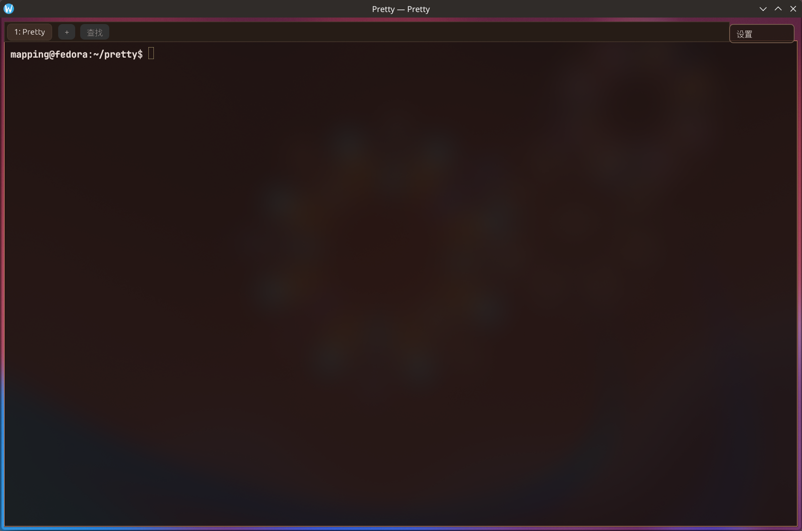
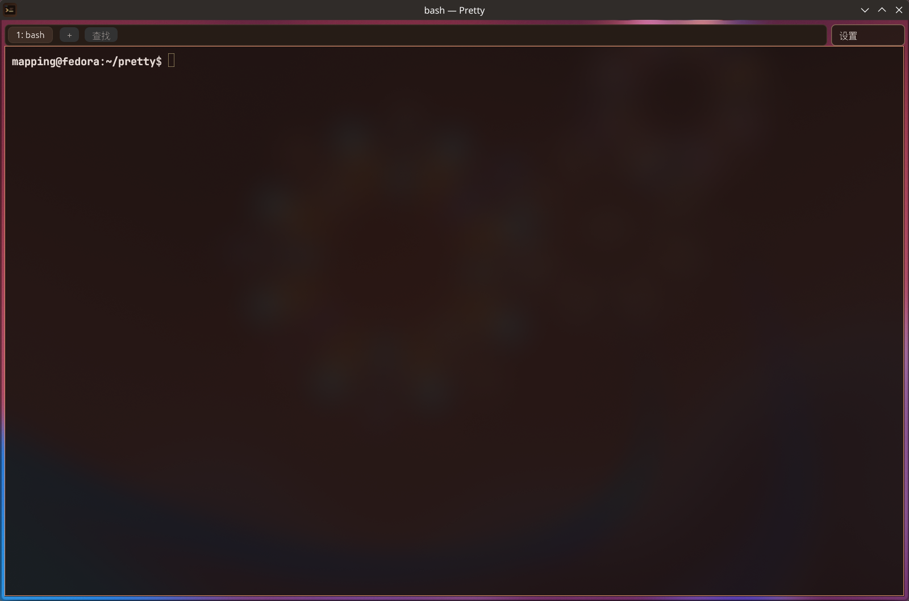

# Pretty v0.2.1 fix and verification report

**Run:** 0.2.1 maintenance release
**Date:** 2026-11-14 (Asia/Shanghai)
**Host:** Fedora 45, KDE Plasma 6.8.2 (Wayland), NVIDIA GTX 1050 /
proprietary 580.196.07, two outputs (DVI-D-1 1920×1080 @ 60 Hz at scale 1,
HDMI-A-1 1920×1200 @ 59.95 Hz at scale 1.25)
**Baseline:** `v0.2.0-pre.1` + the `main` commits after it
**Artifacts:** debug build (`cargo build -p pretty-app`) used for the GUI runs;
release binary built separately. GUI evidence was captured through KWin's
`org.kde.KWin.ScreenShot2` D-Bus API (composited output, not a re-render of the
application buffers).

This release fixes three reported regressions and does not add features. The
three fixes are independent; the tests below exercise each one directly.

## 1. Normal window close was recorded as a crash

### Reproduction

The installed 0.2.0 binary was closed through KWin's
`Scripting.Window.closeWindow()` (the same `CloseRequested` path as the title
bar close button). Every run produced a core dump:

```
$ coredumpctl list --since "5 minutes ago"
TIME                          PID  UID  GID SIG     COREFILE EXE
Sat 2026-11-14 22:45:48 CST 19433 1000 1000 SIGSEGV present  /usr/bin/pretty
```

The captured backtrace (also supplied by the reporter) shows the
`smithay-clipboa` worker in `wl_proxy_destroy`, after the window's Wayland
objects had already been torn down. `egui-winit` implements its Wayland
clipboard with a worker thread that shares winit's `wl_display`; `PrettyApp`
declared `window` and `renderer` before `egui_state`, so Rust's field drop
order destroyed the window surface first and asked the clipboard worker to
clean up afterwards.

### Fix

`PrettyApp::shutdown_clipboard()` explicitly drops `egui_state` (and the
application's `arboard` handle) while winit's display/window are still alive.
It is called from `ApplicationHandler::exiting` and again from `Drop`, so
renderer-creation failures and other early exits follow the same order.

### Verification

Three launch/close cycles with the fixed binary:

```
run 1 exit=0
run 2 exit=0
run 3 exit=0
```

`coredumpctl list` contains no record for any of the three runs. The same
check is repeated in §5.

## 2. Title bar lines, corners, icon, and title

### Before



Problems visible in the reporter's annotated screenshot and reproduced above:

- the KDE title bar showed the generic Wayland icon;
- the title was `Pretty — Pretty`, and the tab was `1: Pretty`, instead of the
  shell/program name;
- the tab-bar frame was 33 points high (6…39) while the settings button was at
  10…40: both its top and bottom lines missed the tab bar and the terminal
  frame;
- the tab-bar frame had square corners while the settings button and tab
  buttons were rounded;
- the settings button's right edge was inset 12 points instead of matching the
  terminal's 6-point frame margin.

### After



- **Icon:** Wayland surfaces now set an explicit `app_id` (`pretty`, or
  `FLATPAK_ID`/`PRETTY_APP_ID` when set) so KWin matches
  `pretty.desktop`; KWin now reports `desktopFileName=pretty` and draws the
  Pretty icon. X11/Windows also receive the embedded `icons/pretty-128.png`
  through `Window::set_window_icon`.
- **Title:** the initial pane title is the configured shell's program name
  (`bash`, `zsh`, …), not the terminal name. `update_title` never emits
  `Pretty — Pretty`; the tab therefore reads `1: bash` and the window
  `bash — Pretty`.
- **Lines:** the tab-bar frame and settings button now share the terminal's
  top line (`margin + tab_bar_height`), bottom line, and the terminal's right
  frame margin. The 33-point tab-bar row was fixed by constraining its content
  to `height - 6` and using compact button padding; the frame's outer height is
  now exactly 30 points for the default `tab_bar_height = 30`.
- **Radii:** the tab-bar frame, every tab button, `+`, Find, and the settings
  button all use the settings button's 6-point radius
  (`settings::CHROME_CORNER_RADIUS`).

The pure layout helper is covered by
`app::tests::chrome_row_follows_the_terminal_frame_lines`; the title fallback is
covered by `app::tests::fallback_title_is_the_program_not_the_terminal_name`.

## 3. Fullscreen title-bar flicker

### Root cause

The title bar is drawn inside the window, so any compositor-level flash there
is driven by how often the window presents frames. While investigating the
fullscreen report, the composited output was frozen for tens of seconds and the
idle window was nevertheless continuously redrawing:

```
idle redraw interval: 492 frames, avg 16.67 ms
```

The cause was a feedback loop in `update_ime_area`: every frame called
`Window::set_ime_cursor_area` even when the terminal cursor had not moved.
KWin/Fcitx acknowledged each call with `TextInputEvent::Done`, winit surfaced
that as `Ime::Preedit("")`, and the application requested another redraw. The
same debug log contained 1,681 `request_redraw` calls and 1,365 empty preedit
events in 13 seconds, with the main thread at 31–45% CPU while the terminal sat
idle. In fullscreen the transparent title-bar strip is composited directly by
KWin; that continuous present/IME cycle is what produces the white/black flash
above the Find button (and it explains why a still screenshot cannot capture
it reliably).

### Fix

The last physical IME cursor rectangle is cached in `PrettyApp::ime_area` and
`set_ime_cursor_area` is only called when the rectangle actually changes. The
cache is reset when the cursor/settings/search state hides the IME area.

### Verification

After the fix, with the same fullscreen window and debug logging:

```
idle redraw interval: 24 frames, avg 437.12 ms
IME preedit events after startup: 2 (the initial clear only)
process CPU while idle: 4.4% (debug build; previously 31–45%)
```

24 frames per 10 seconds is the cursor-blink cadence (530 ms configured with
the 16 ms timer tick), not compositor-rate repainting. Captures of the
fullscreen title bar at both outputs still show the expected 6-point transparent
margin and no layout change.

The probabilistic flash is timing-dependent and was not frozen in a still
capture; the frame-pacing regression that caused it is measurable and is fixed.
If a future KWin/NVIDIA combination still flashes only while presenting active
content, that would be a compositor bug rather than an idle-redraw storm; the
test-report's frame counts make that distinction observable.

## 4. Regression tests

```
$ cargo test --workspace
...
test result: ok. 44 passed; 0 failed; 0 ignored (pretty-app)
test result: ok. 61 passed; 0 failed; 0 ignored (pretty-core unit tests)
test result: ok. 9 passed; 0 failed; 0 ignored (audit_020)
test result: ok. 2 passed; 0 failed; 1 ignored (pty_smoke)
test result: ok. 4 passed; 0 failed; 0 ignored (qa_v020)
test result: ok. 15 passed; 0 failed; 0 ignored (pretty-renderer)
```

`cargo test --workspace --all-targets` and `cargo build -p pretty-app` also
complete without errors on stable Rust 1.100.

## 5. Final GUI close check

After bumping the workspace version to 0.2.1 and rebuilding:

- `pretty --fullscreen` on the upper 1920×1080 output: launches, renders the
  tab bar/settings row on the same lines, and is responsive;
- closing via KWin's `closeWindow()`: exit status 0, no new `coredumpctl`
  entry;
- the X11/GLES path was not re-run with a compositor in this pass; the change
  only affects teardown order and is shared by both platforms.

## Limitations

- The fullscreen flash is intermittent. It was investigated by frame-pacing
  logs and composited screenshots, not by a hardware screen recorder; the
  before/after frame counts above are the reproducible evidence.
- Mixed-DPI output (scale 1.25) was checked for the chrome screenshots; the
  compositor still scales that output as before.
- No other UI or terminal behaviour was changed for this release.
