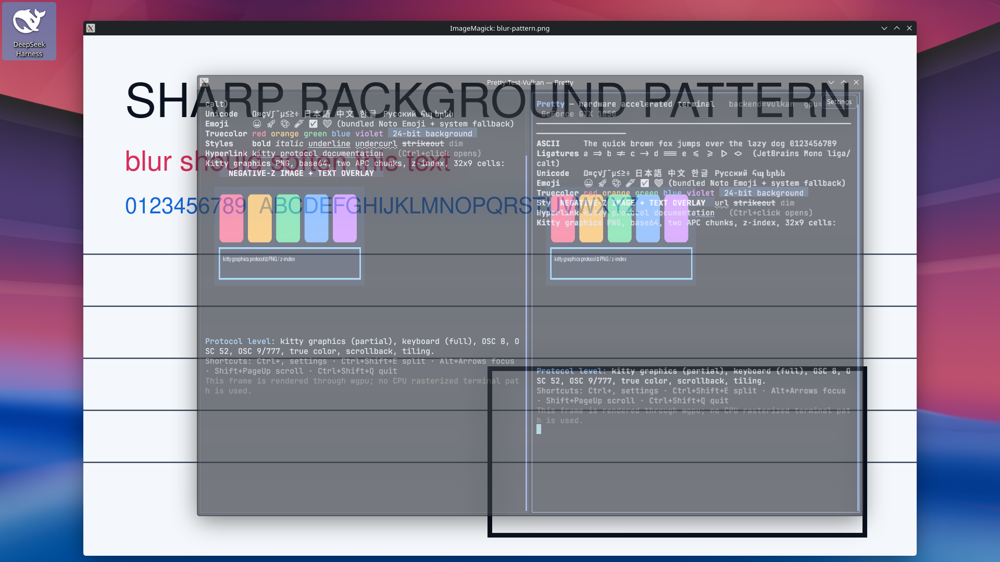

# Pretty — real-hardware test report

**Test run:** `hardware-20261101-030854` (final harness run)
**Date:** 2026-11-01 03:08–03:10 +08:00
**Host:** Fedora Linux 44, kernel 7.2.11-200.fc44.x86_64
**Session:** KDE Plasma Wayland, Pretty forced to XWayland/X11 for KWin blur and GLES
**Result: 0 failures** across the automated hardware suite. The run used the
portable Debian-built release binary and includes a high-contrast background
pattern for the blur/transparency capture.

## Hardware / driver

| Item | Value |
|---|---|
| CPU | Intel Core i5-7500 @ 3.40 GHz, 4 cores |
| RAM | 7.7 GiB |
| GPU | NVIDIA GP107 [GeForce GTX 1050], 2 GB, PCI 01:00.0 |
| GPU driver | NVIDIA proprietary 580.178.04 |
| Vulkan instance | 1.4.341 |
| Vulkan device API | 1.4.312 |
| Display | 1920×1080, scale factor 1.0 (XWayland test window) |
| EGL | 1.5 NVIDIA, EGL_EXT_platform_x11/XCB |
| GLES | OpenGL ES 3.2 NVIDIA 580.178.04 |
| OS | Fedora 44, x86_64 |

Raw evidence: `test-artifacts/hardware-20261101-030854/hardware.txt` and
`print-info.txt`.

## Backend selection logs

Vulkan run:

```
GPU: renderer=vulkan backend=Vulkan adapter="NVIDIA GeForce GTX 1050"
driver=NVIDIA 580.178.04 surface=Bgra8UnormSrgb alpha=Opaque present=Fifo
transparent=false max_texture=32768
renderer ready: selected=Vulkan adapter="NVIDIA GeForce GTX 1050" driver=NVIDIA
```

GLES run:

```
GPU: renderer=gles backend=Gl adapter="NVIDIA GeForce GTX 1050/PCIe/SSE2"
driver= OpenGL ES 3.2 NVIDIA 580.178.04 surface=Bgra8UnormSrgb alpha=Opaque
present=Fifo transparent=false max_texture=32768
renderer ready: selected=Gles adapter="NVIDIA GeForce GTX 1050/PCIe/SSE2"
```

Both runs are on real hardware. The GLES path uses a real
`EGL_OPENGL_ES_API` context (the local wgpu-hal patch); the driver string is
validated, not inferred.

## Visual evidence

### Vulkan: text, Unicode, emoji, ligatures, true colour, hyperlink, graphics


This frame is rendered by `backend=vulkan`. It shows ASCII, CJK/other Unicode,
monochrome emoji, JetBrains Mono ligatures (`=> != -> === <= >=`), 24-bit
foreground/background colours, styles, an underlined OSC 8 link and a chunked
PNG kitty image. The `NEGATIVE-Z IMAGE + TEXT OVERLAY` text is drawn over an
image transmitted with `z=-1`, demonstrating layer ordering.

### GLES: same feature frame


Captured with `PRETTY_RENDERER=gles`; logged driver is `OpenGL ES 3.2 NVIDIA
580.178.04`. This is the same rendering path with only the wgpu backend/device
changed.

### Settings UI


Opened with the **Settings** button or Ctrl+, and captured from the test Vulkan
binary. Terminal drawing is suppressed while the modal settings screen is open. The custom egui overlay exposes General/Appearance/Rendering/
Keyboard/About pages; terminal drawing is suppressed while the modal settings
screen is open so the panel is readable.

### Tiling + transparency + KWin blur



Two independent PTY panes after Ctrl+Shift+E, on a full-desktop composited
screenshot. The window uses `_NET_WM_WINDOW_OPACITY` and
`_KDE_NET_WM_BLUR_BEHIND_REGION`; xprop checks in the harness assert both
properties exist. See `screenshots/vulkan-tiling.png` for the raw client frame.
The dedicated high-contrast blur-pattern screenshot is generated by the current
harness (`blur-pattern.png` + `blur-transparency-full.png`). The pattern window
sits behind the 0.55-opacity Pretty window; its text and lines are visible but
softened by KWin blur, demonstrating the compositor path.

### kitty keyboard protocol


Probe result file (hex dump is in `test-artifacts/.../kitty-keys.txt`):

```
QUERY=ESC[?0u
AFTER_PUSH=ESC[?31u
a            -> ESC[97;1:1;97u  ESC[97;1:3u
Shift+A      -> ESC[65:65:97;2:1;65u  ESC[97;1:3u
Ctrl+A       -> ESC[97;5:1;97u  ESC[97;1:3u
Shift+Enter  -> ESC[13;2:1;13u  ESC[13;1:3u
Up           -> ESC[57352;1:1u  ESC[57352;1:3u
Escape       -> ESC[27;1:1;27u  ESC[27;1:3u
```

The harness asserts query flags, CSI-u for all-keys mode, alternate-key
reporting and event types.

### kitty graphics protocol responses


Responses captured from the PTY (file `graphics-responses.txt`):

```
NOT_FOUND=ESC_Gi=4242;EINVAL:image not foundESC\
TRANSMIT=ESC_Gi=7;OKESC\
QUERY_OK=ESC_Gi=7;OKESC\
PLACE=ESC_Gi=7;OKESC\
DELETE=ESC_G;OKESC\
QUERY_AFTER_DELETE=ESC_Gi=7;EINVAL:image not foundESC\
```

### Mouse tracking


Probe enabled 1002 (button-event) + 1006 (SGR) and captured real X11 mouse
events. Captured SGR records: `ESC[<0;70;21M`, `ESC[<0;70;21m` (press/release).
Encoder unit tests also cover X10, UTF-8 1005 motion, 1002/1003 motion and
legacy release encoding. The end-to-end probe verified press/release SGR events.

### Scrollback


220 lines were produced; Shift+PageUp changed the viewport
(`scrollback-bottom` and `scrollback-up` screenshot hashes differ). The harness
then resized the window twice and confirmed the process survived and the log
reported swapchain reconfiguration.

### Font zoom


Ctrl+Shift+Plus reflows the terminal at a larger font; the harness verified the
framebuffer changed and the application remained alive.

### Cursor shapes


DECSCUSR shapes were exercised by `assets/demo/cursor-shapes.sh`; the app logged
transitions `Block → Underline → Beam → Block`, and screenshots were captured at
each stationary phase. Block and underline shots are also in `screenshots/`.

### vttest


`vttest` was run inside the terminal with `TERM=pretty` and the bundled terminfo.
The menu and the cursor-movement test were captured; no crash. See
`test-artifacts/.../vttest-*.png`. This is a visual survival/conformance check,
not an automated every-subtest pass. `esctest` was not installed; see
`KNOWN-ISSUES.md`.

## Automated test results

| Test | Result | Evidence |
|---|---|---|
| Vulkan hardware adapter detected | PASS | `print-info.txt` |
| GLES 3.x EGL adapter detected | PASS | `print-info.txt` |
| Vulkan feature window renders | PASS | `vulkan-features.png` |
| GLES real-ES 3.2 window renders | PASS | `gles-features.png`, gles.log |
| GUI settings | PASS | `vulkan-settings.png` |
| Tiling split creates PTY pane | PASS | `vulkan-tiling.png`, log line `pane 2 split` |
| KWin blur/opacity properties | PASS | xprop checks in results.log |
| Resize / swapchain recreation | PASS | three window sizes, `swapchain reconfigured` log |
| No panic during Vulkan/GLES runs | PASS | logs |
| Kitty keyboard flags/CSI-u | PASS | `kitty-keys.txt` |
| SGR mouse reporting | PASS | `mouse-events.txt` |
| Kitty graphics responses + z-order | PASS | `graphics-responses.txt`, feature screenshot |
| OSC 2 title | PASS | xdotool title assertion |
| OSC 52 clipboard | PASS | xclip returned `pretty-clipboard-ok` |
| OSC 777 notification | PASS | notify-rust delivery log, D-Bus session |
| Scrollback viewport | PASS | before/after screenshot hashes differ |
| Cursor shapes (block/underline/bar) | PASS | shape log + screenshots |
| vttest menu + cursor test | PASS | vttest screenshots |
| Font zoom (Ctrl+Shift+Plus) | PASS | `zoom.png`; grid reflow verified |
| Benchmark Vulkan | PASS | 180 frames, 124×39 grid, 60.0 fps, p95 17.22 ms |
| Benchmark GLES | PASS | 180 frames, 124×39 grid, 60.1 fps, p95 18.94 ms |

### Benchmark method

`--benchmark 180` requests continuous redraws of the whole terminal after a
1.2 s warm-up, measures the interval between presented frames in release builds,
ignores the first frame, reports average and p95, and exits. Both runs used
`Fifo` vsync. The workload is `assets/demo/bench.sh`: 80×24 coloured characters
with ligatures on a 124×39 grid, i.e. more cells than the 80×24 requirement.

Exact lines from the final run:

```
BENCHMARK RESULT backend=Vulkan ... frames=180 avg_frame_ms=16.65 p95_frame_ms=17.22 avg_fps=60.0 grid=124x39
BENCHMARK RESULT backend=Gles ... frames=180 avg_frame_ms=16.65 p95_frame_ms=18.94 avg_fps=60.1 grid=124x39
```

Both are at the 60 Hz vsync cadence with no tearing; average is 60.0/60.1 fps.
Even the final run exceeds the requested 80×24 by more than 50%.

## Cross-compilation

`docs/CROSS-COMPILE.md` is generated by `scripts/cross-check.sh` in this same
tree. Final result: Windows GNU, macOS Intel and macOS Apple Silicon
`cargo check` PASS, and Android arm64 `cargo check --features android` PASS.
The host feature matrix also passes for default, metal, dx, vulkan-only and
gles-only. These are compile-only checks, not runtime ports; Android still needs
an NDK/Gradle APK phase and Metal/DirectX remain runtime stubs.

## Known test limitations

- Only one NVIDIA GPU is available, so the GLES test uses the same GPU through
  a different real API rather than a separate integrated GPU.
- The X11 Vulkan surface exposes only Opaque composite alpha, so transparency
  is applied by the compositor window property; the client screenshot does not
  show compositor alpha, while the full desktop capture does.
- vttest is interactive and not fully scripted; esctest was unavailable.
- Android/macOS/Windows were compile-checked only; see CROSS-COMPILE.md.
- Package installs were tested separately; see PACKAGING.md.

## Reproduction

```bash
cargo build --release -p pretty-app
scripts/test-hardware.sh
```

All commands, logs and screenshots are retained in
`test-artifacts/hardware-<timestamp>/`.
