# Pretty — real-hardware test report

**Test run:** `hardware-20261101-123811` (final harness run)
**Date:** 2026-11-01 12:36–12:40 +08:00
**Host:** Fedora Linux 44, kernel 7.2.11-200.fc44.x86_64
**Session:** KDE Plasma Wayland, Pretty forced to XWayland/X11 for KWin blur and GLES
**Result: 0 failures** across the automated hardware suite. The run includes
X11 per-pixel ARGB alpha checks and a high-contrast background pattern for the
blur/transparency capture.

## Hardware / driver

| Item | Value |
|---|---|
| CPU | Intel Core i5-7500 @ 3.40 GHz, 4 cores |
| RAM | 7.7 GiB |
| GPU | NVIDIA GP107 [GeForce GTX 1050], 2 GB, PCI 01:00.0 |
| GPU driver | NVIDIA proprietary 580.178.04 |
| Vulkan instance | 1.4.341 |
| Vulkan device API | 1.4.312 |
| Display | 1920×1080, scale factor 1.0 (XWayland test window) |
| EGL | 1.5 NVIDIA, EGL_EXT_platform_x11/XCB |
| GLES | OpenGL ES 3.2 NVIDIA 580.178.04 |
| OS | Fedora 44, x86_64 |

Raw evidence: `test-artifacts/hardware-20261101-123811/hardware.txt` and
`print-info.txt`.

## Backend selection logs

Vulkan run:

```
GPU: renderer=vulkan backend=Vulkan adapter="NVIDIA GeForce GTX 1050"
driver=NVIDIA 580.178.04 surface=Bgra8UnormSrgb alpha=Opaque present=Fifo
transparent=false max_texture=32768
renderer ready: selected=Vulkan adapter="NVIDIA GeForce GTX 1050" driver=NVIDIA
```

GLES run:

```
GPU: renderer=gles backend=Gl adapter="NVIDIA GeForce GTX 1050/PCIe/SSE2"
driver= OpenGL ES 3.2 NVIDIA 580.178.04 surface=Bgra8UnormSrgb alpha=Opaque
present=Fifo transparent=false max_texture=32768
renderer ready: selected=Gles adapter="NVIDIA GeForce GTX 1050/PCIe/SSE2"
```

Both runs are on real hardware. The GLES path uses a real
`EGL_OPENGL_ES_API` context (the local wgpu-hal patch); the driver string is
validated, not inferred.

## Visual evidence

### Vulkan: text, Unicode, emoji, ligatures, true colour, hyperlink, graphics


This frame is rendered by `backend=vulkan`. It shows ASCII, CJK/other Unicode,
monochrome emoji, JetBrains Mono ligatures (`=> != -> === <= >=`), 24-bit
foreground/background colours, styles, an underlined OSC 8 link and a chunked
PNG kitty image. The `NEGATIVE-Z IMAGE + TEXT OVERLAY` text is drawn over an
image transmitted with `z=-1`, demonstrating layer ordering.

### GLES: same feature frame

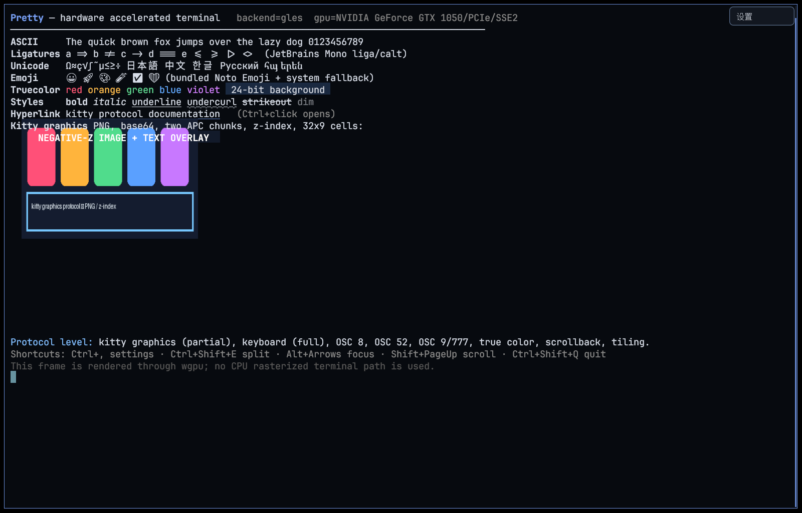

Captured with `PRETTY_RENDERER=gles`; logged driver is `OpenGL ES 3.2 NVIDIA
580.178.04`. This is the same rendering path with only the wgpu backend/device
changed.

### Settings UI

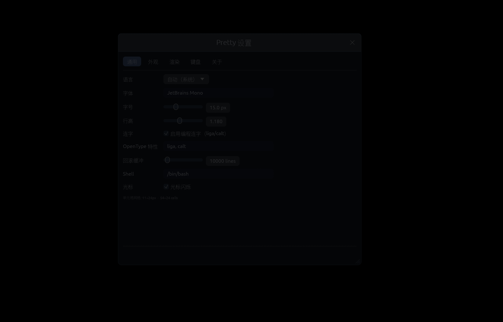

Opened with the **Settings** button or Ctrl+, and captured from the test Vulkan
binary. Terminal drawing is suppressed while the modal settings screen is open. The custom egui overlay exposes General/Appearance/Rendering/
Keyboard/About pages; terminal drawing is suppressed while the modal settings
screen is open so the panel is readable.

### Tiling + transparency + KWin blur

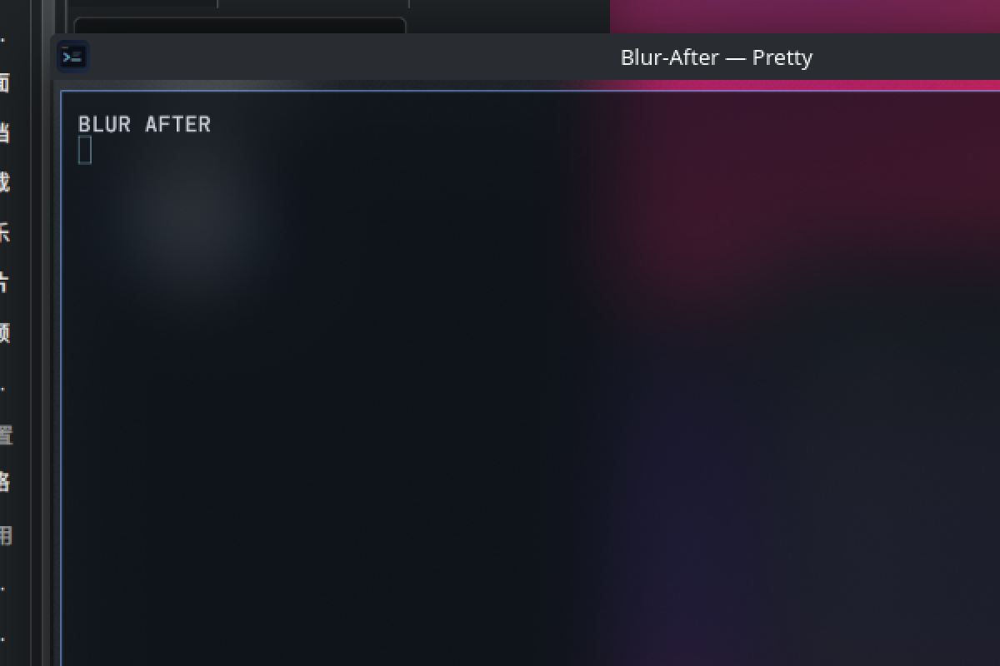

The window uses a 32-bit ARGB client buffer with per-pixel alpha and
`_KDE_NET_WM_BLUR_BEHIND_REGION`; it deliberately has no
`_NET_WM_WINDOW_OPACITY`. The terminal foreground stays opaque while KWin blurs
the alpha background. `screenshots/vulkan-tiling.png` shows the separate
two-PTY tiling frame, and `screenshots/ux-blur-before.png` is the old
whole-window-opacity behavior that showed sharp (unblurred) desktop content.
The current hardware harness asserts `pixel_alpha=true`, the blur region, and the
absence of the legacy opacity property.

### kitty keyboard protocol

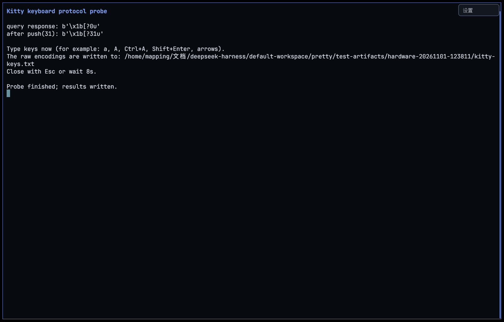

Probe result file (hex dump is in `test-artifacts/.../kitty-keys.txt`):

```
QUERY=ESC[?0u
AFTER_PUSH=ESC[?31u
a            -> ESC[97;1:1;97u  ESC[97;1:3u
Shift+A      -> ESC[65:65:97;2:1;65u  ESC[97;1:3u
Ctrl+A       -> ESC[97;5:1;97u  ESC[97;1:3u
Shift+Enter  -> ESC[13;2:1;13u  ESC[13;1:3u
Up           -> ESC[57352;1:1u  ESC[57352;1:3u
Escape       -> ESC[27;1:1;27u  ESC[27;1:3u
```

The harness asserts query flags, CSI-u for all-keys mode, alternate-key
reporting and event types.

### kitty graphics protocol responses

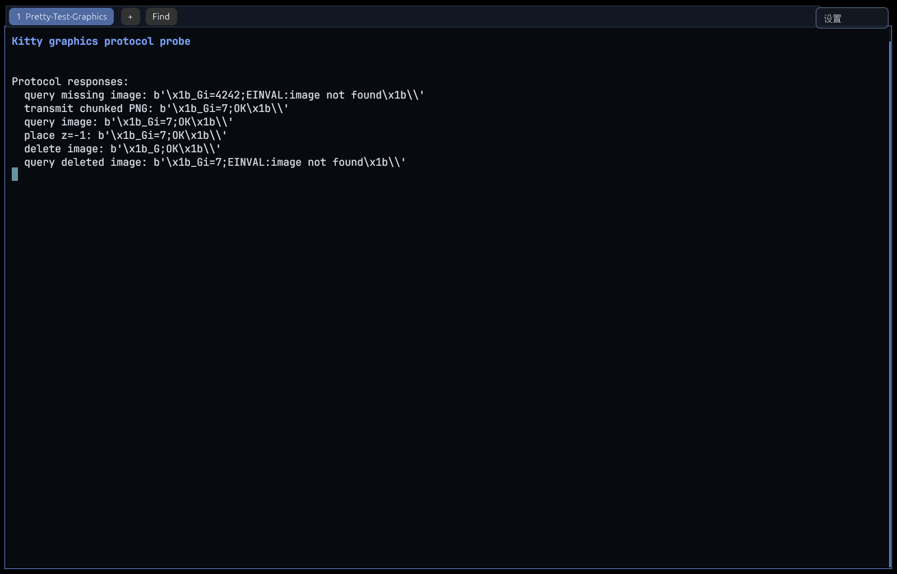

Responses captured from the PTY (file `graphics-responses.txt`):

```
NOT_FOUND=ESC_Gi=4242;EINVAL:image not foundESC\
TRANSMIT=ESC_Gi=7;OKESC\
QUERY_OK=ESC_Gi=7;OKESC\
PLACE=ESC_Gi=7;OKESC\
DELETE=ESC_G;OKESC\
QUERY_AFTER_DELETE=ESC_Gi=7;EINVAL:image not foundESC\
```

### Mouse tracking

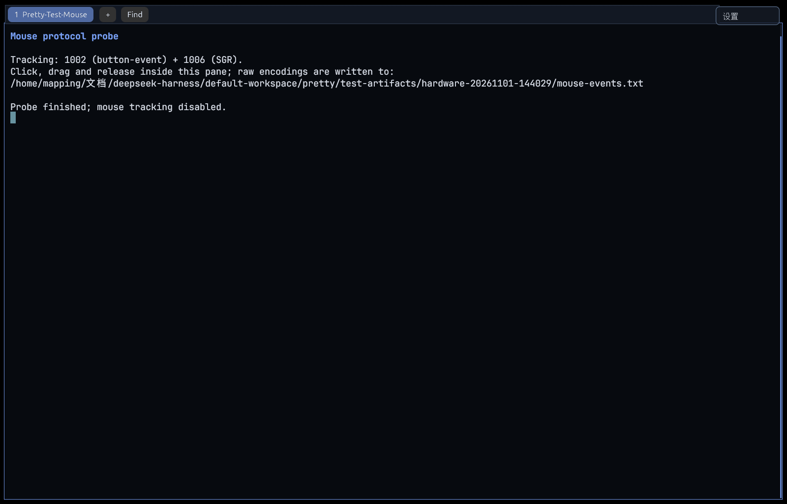

Probe enabled 1002 (button-event) + 1006 (SGR) and captured real X11 mouse
events. Captured SGR records: `ESC[<0;70;21M`, `ESC[<0;70;21m` (press/release).
Encoder unit tests also cover X10, UTF-8 1005 motion, 1002/1003 motion and
legacy release encoding. The end-to-end probe verified press/release SGR events.

### Scrollback

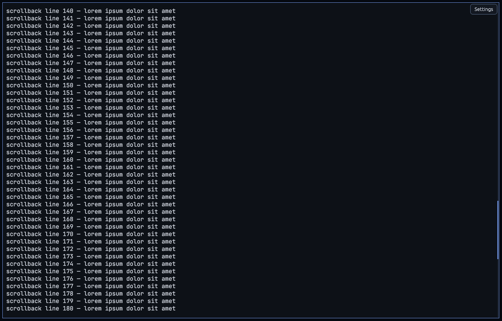

220 lines were produced; Shift+PageUp changed the viewport
(`scrollback-bottom` and `scrollback-up` screenshot hashes differ). The harness
then resized the window twice and confirmed the process survived and the log
reported swapchain reconfiguration.

### Font zoom

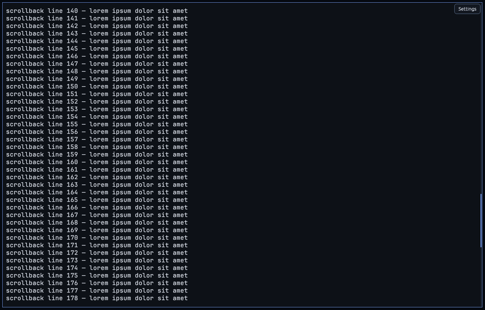

Ctrl+Shift+Plus reflows the terminal at a larger font; the harness verified the
framebuffer changed and the application remained alive.

### Cursor shapes

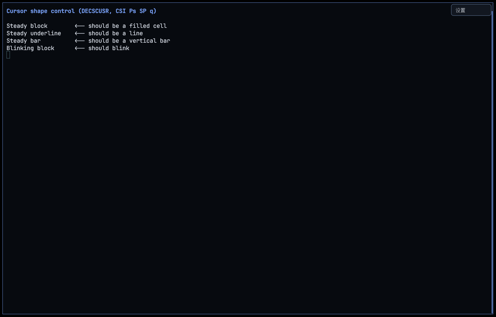

DECSCUSR shapes were exercised by `assets/demo/cursor-shapes.sh`; the app logged
transitions `Block → Underline → Beam → Block`, and screenshots were captured at
each stationary phase. Block and underline shots are also in `screenshots/`.

### vttest

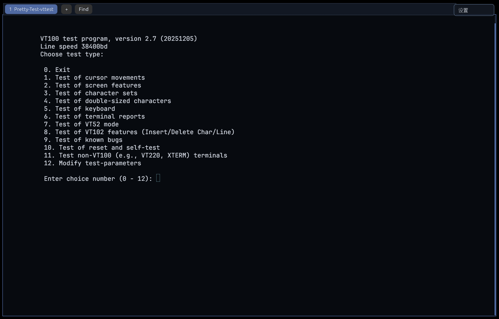

`vttest` was run inside the terminal with `TERM=pretty` and the bundled terminfo.
The menu and the cursor-movement test were captured; no crash. See
`test-artifacts/.../vttest-*.png`. This is a visual survival/conformance check,
not an automated every-subtest pass. `esctest` was not installed; see
`KNOWN-ISSUES.md`.

## Automated test results

| Test | Result | Evidence |
|---|---|---|
| Vulkan hardware adapter detected | PASS | `print-info.txt` |
| GLES 3.x EGL adapter detected | PASS | `print-info.txt` |
| Vulkan feature window renders | PASS | `vulkan-features.png` |
| GLES real-ES 3.2 window renders | PASS | `gles-features.png`, gles.log |
| GUI settings | PASS | `vulkan-settings.png` |
| Tiling split creates PTY pane | PASS | `vulkan-tiling.png`, log line `pane 2 split` |
| KWin blur + per-pixel alpha | PASS | `pixel_alpha=true`; `_NET_WM_WINDOW_OPACITY` absent; blur region present |
| Resize / swapchain recreation | PASS | three window sizes, `swapchain reconfigured` log |
| No panic during Vulkan/GLES runs | PASS | logs |
| Kitty keyboard flags/CSI-u | PASS | `kitty-keys.txt` |
| SGR mouse reporting | PASS | `mouse-events.txt` |
| Kitty graphics responses + z-order | PASS | `graphics-responses.txt`, feature screenshot |
| OSC 2 title | PASS | xdotool title assertion |
| OSC 52 clipboard | PASS | xclip returned `pretty-clipboard-ok` |
| OSC 777 notification | PASS | notify-rust delivery log, D-Bus session |
| Scrollback viewport | PASS | before/after screenshot hashes differ |
| Cursor shapes (block/underline/bar) | PASS | shape log + screenshots |
| vttest menu + cursor test | PASS | vttest screenshots |
| Font zoom (Ctrl+Shift+Plus) | PASS | `zoom.png`; grid reflow verified |
| Benchmark Vulkan | PASS | 180 frames, 141×40 grid, 59.9 fps, p95 17.85 ms |
| Benchmark GLES | PASS | 180 frames, 141×40 grid, 60.0 fps, p95 17.91 ms |

### Benchmark method

`--benchmark 180` requests continuous redraws of the whole terminal after a
1.2 s warm-up, measures the interval between presented frames in release builds,
ignores the first frame, reports average and p95, and exits. Both runs used
`Fifo` vsync. The workload is `assets/demo/bench.sh`: 80×24 coloured characters
with ligatures on a 141×40 grid, i.e. more cells than the 80×24 requirement.

Exact lines from the final run:

```
BENCHMARK RESULT backend=Vulkan ... frames=180 avg_frame_ms=16.68 p95_frame_ms=17.85 avg_fps=59.9 grid=141x40
BENCHMARK RESULT backend=Gles ... frames=180 avg_frame_ms=16.67 p95_frame_ms=17.91 avg_fps=60.0 grid=141x40
```

Both are at the 60 Hz vsync cadence with no tearing; average is 59.9/60.0 fps.
The run exceeds the requested 80×24 by more than 2× in cell count.

## Cross-compilation

`docs/CROSS-COMPILE.md` is generated by `scripts/cross-check.sh` in this same
tree. Final result: Windows GNU, macOS Intel and macOS Apple Silicon
`cargo check` PASS, and Android arm64 `cargo check --features android` PASS.
The host feature matrix also passes for default, metal, dx, vulkan-only and
gles-only. These are compile-only checks, not runtime ports; Android still needs
an NDK/Gradle APK phase and Metal/DirectX remain runtime stubs.

## Follow-up UX hardening (2026-11-01)

The original UX complaints were reproduced on this host and addressed in the
application/input layers. Evidence is retained in
`test-artifacts/ux-20261101-1128/` and in the screenshots below.

### mpv `--vo=kitty`

The failure was resource growth: mpv transmits each opaque RGB frame with an
auto-assigned image id and `q=2` at the same cell. Before the fix, the 256-image
table filled and the image renderer retained every texture. Now an opaque
`format=24` auto-id placement at the same anchor replaces the previous one, and
a 256 MiB/256-image resource guard evicts least-recently-created images; the GPU
texture cache is pruned every frame.

A 15 s, 30 fps H.264 testsrc was played by `mpv --vo=kitty` (1152×648 output):
**No image-table errors and no freezes occurred**: a longer run accepted 441
frames, RSS stayed around 226 MiB, and the UI continued rendering. In the final
non-debug run the app used about 57–67% of one CPU core; video playback progressed
below the source's 30 fps because image decode/upload is still synchronous on
the UI thread. This is a throughput limitation, not the previous freeze. The
playback screenshot shows live video, not a frozen first frame:

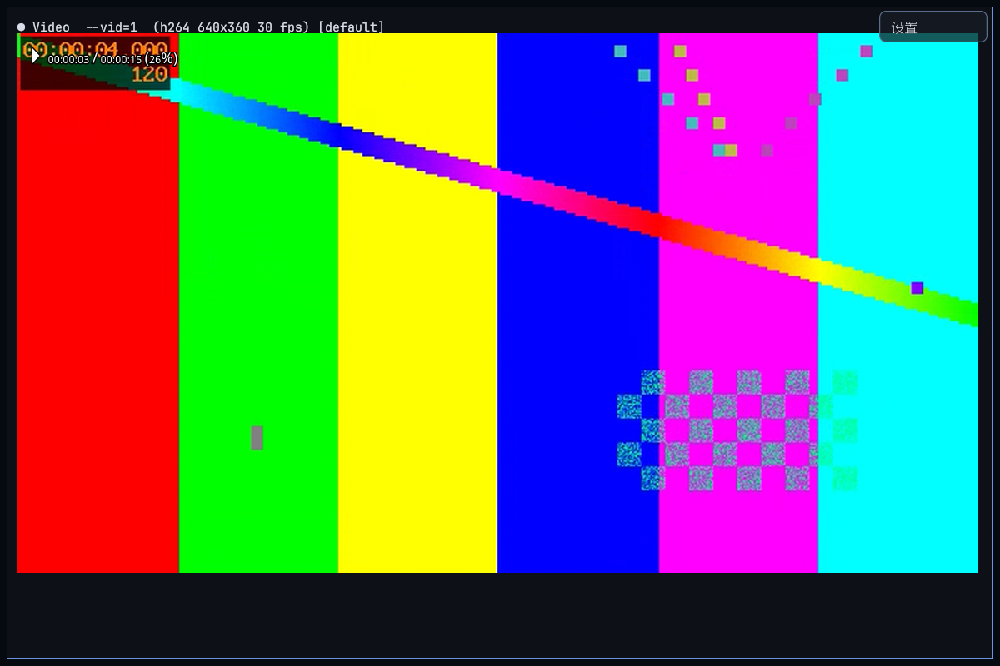

### Compositor blur: one ARGB alpha layer, not two stacked effects

The user's screenshot exposed a real KWin integration bug, not merely a strong
opacity setting. KWin only applies its blur effect to a client buffer that has
alpha. The Vulkan X11 surface advertises an opaque composite mode, so applying
only `_NET_WM_WINDOW_OPACITY` made the window translucent while **the client
buffer remained opaque**. The result was a transparent (whole-window) layer over
an *unblurred* desktop; text was also faded because compositor opacity applied to
the entire window.

The X11 path now automatically enables **per-pixel ARGB alpha** when
`opacity < 1`:

- the framebuffer is cleared with alpha 0;
- the terminal background is drawn with `alpha = config.opacity`;
- text, images and the settings UI content keep alpha 1 (opaque);
- `_NET_WM_WINDOW_OPACITY` is removed when this path is active, while
  `_KDE_NET_WM_BLUR_BEHIND_REGION` remains set.

KWin therefore sees one translucent background layer with alpha, applies the
blur to it, and leaves the foreground text crisp. This works with both the
Vulkan and GLES backends (ARGB X11 window depth 32).

Before: KWin produced transparency without blur; the Dolphin icon and text are
sharply readable through the terminal.

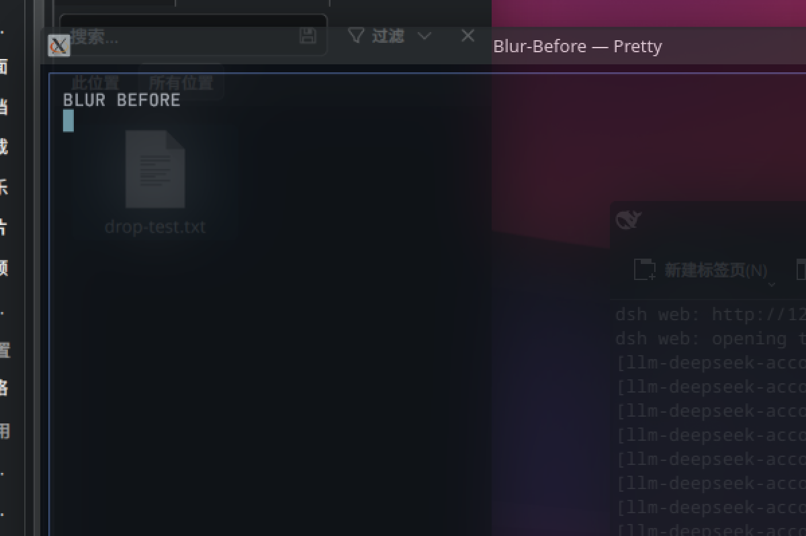

After: the same background is actually blurred; the terminal foreground remains
opaque and crisp.


The runtime log for the after case shows `pixel_alpha=true`; `xprop` no longer
contains `_NET_WM_WINDOW_OPACITY`, while the blur region is still present.

### Touchscreen

The host exposes a `wch.cn TouchScreen` (XInput2 touch device). A synthetic
uinput touch sequence was delivered through XWayland to the final binary and
logged by the app:

```
touch start id=9 at PhysicalPosition { x: 360.98, y: 405.99 }
touch end   id=9 at PhysicalPosition { x: 435.98, y: 455.99 }
```

Winit X11 touch events are now routed as: tap → focus, one-finger drag →
selection, two-finger vertical gesture → scrollback; when the application has
mouse reporting enabled a tap/drag is translated to left-button press/motion/
release. The physical touchscreen path is the same XInput2 path; the synthetic
injection verifies event delivery and coordinates.

### External files: drag and paste

Dolphin was used as a real XDG drag source. Dragging `drop-test.txt` into the
terminal inserted the shell-quoted path:

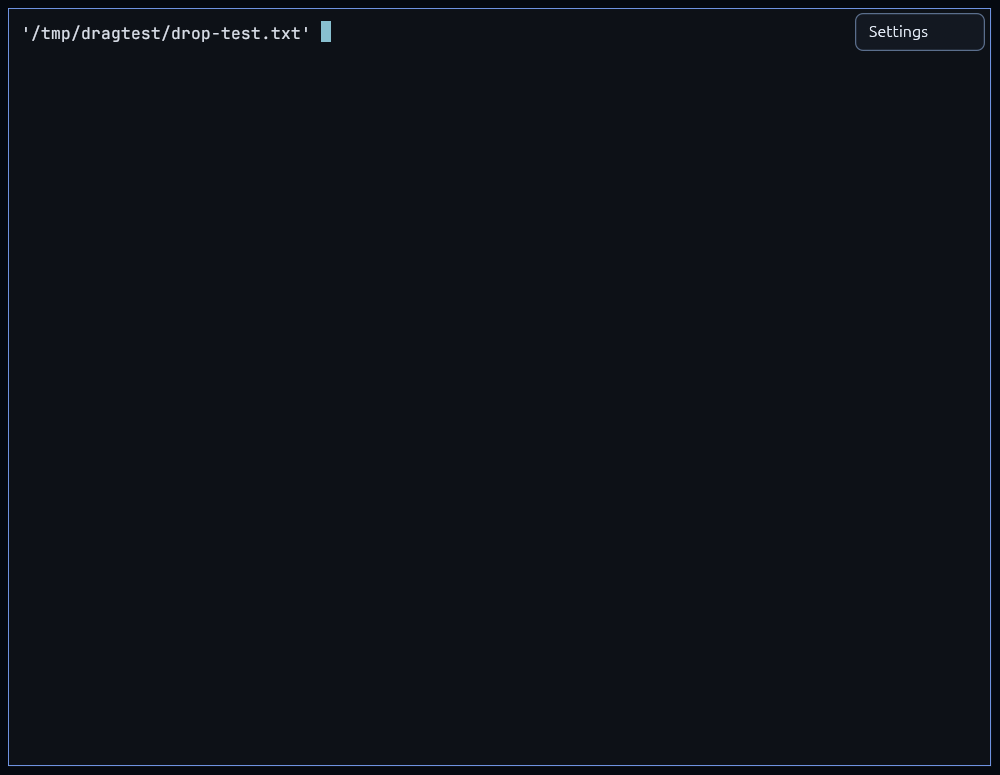

Copying the same file in Dolphin puts a `file:///...` URI on the clipboard.
Ctrl+Shift+V now detects that URI form, percent-decodes it and inserts the
quoted local path instead of the raw URI:

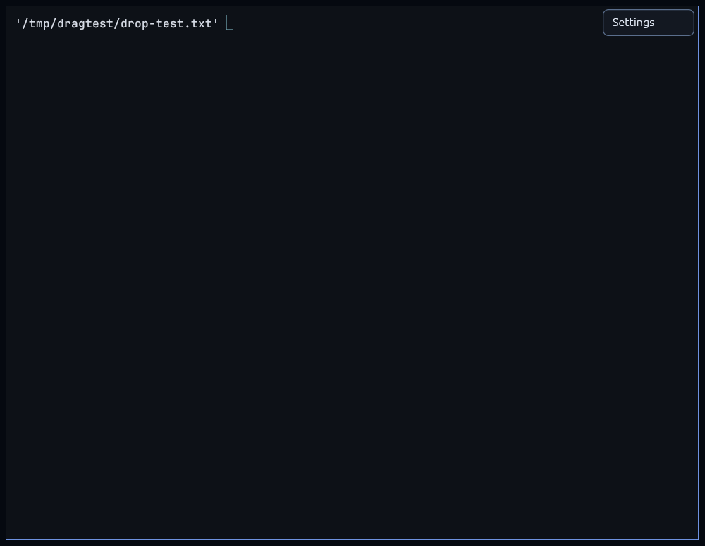

A unit test covers spaces, embedded single quotes, `file://localhost`, multiple
URI lines and percent-decoding.

### IME

Fcitx5 was already running, but the X11 session had no `XMODIFIERS`; XWayland
clients therefore could not reach the XIM server. Pretty now sets
`XMODIFIERS=@im=fcitx` only when Fcitx5 is running and the variable is absent,
enables winit IME, updates `set_ime_cursor_area` from the terminal cursor, and
handles `Ime::Preedit`/`Commit` (with a small inline preedit overlay).

Typing `nihao` through Fcitx Pinyin and committing with Space/Return inserted
the UTF-8 bytes for `你好` (commit length 6 bytes); the screenshot shows both
committed Chinese lines:

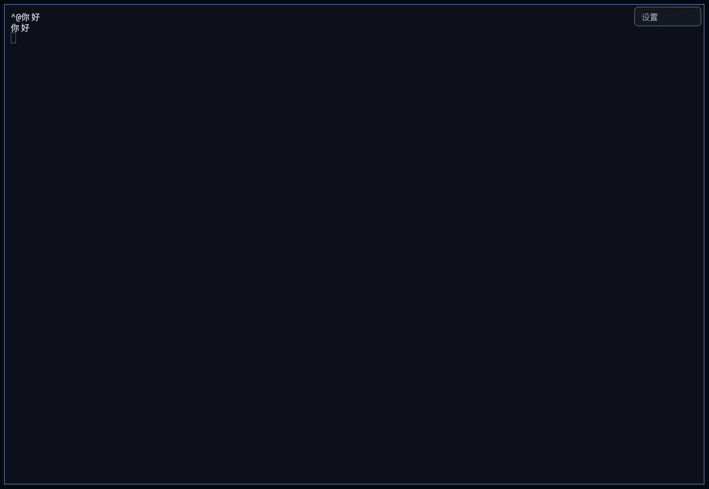

The candidate window itself is drawn by Fcitx, not Pretty.

### Context menu, language and sizing

Right-click in the terminal (or Shift+right-click while an application has
mouse reporting enabled) opens the native egui context menu:

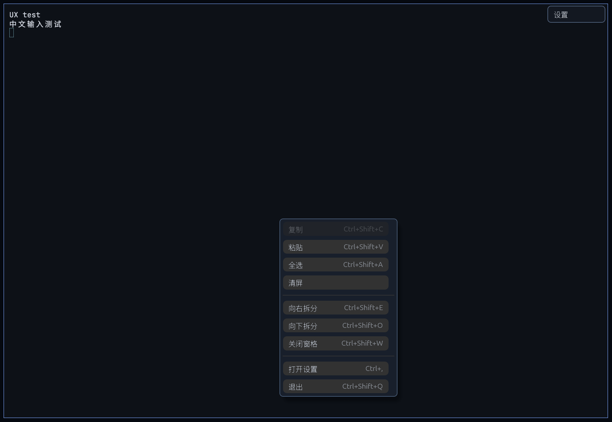

The menu provides copy, paste, select all, clear, split-right/down, close pane,
settings and quit. Disabled copy is visibly greyed out when there is no
selection.

The UI is now localised without a new runtime dependency. The system locale is
`LANG=zh_CN.UTF-8`, so auto mode selected Chinese; a system Noto Sans CJK face
is inserted into egui as a fallback, and the Settings page offers Auto / English
/ 简体中文. The settings screenshot shows the localised page:

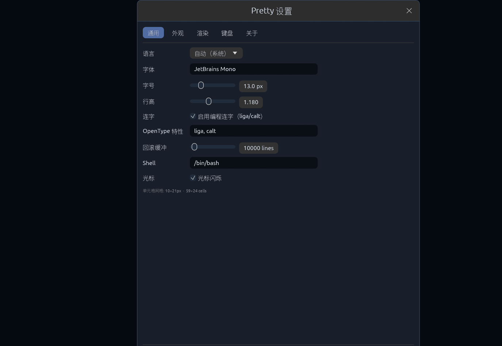

The top-right Settings button now has an explicit `104×30` logical minimum size,
so opening and closing Settings cannot change its layout size. The cursor blink
off-phase now draws a dim outline instead of making the cursor disappear; this
keeps the insertion point visible while remaining clearly blinking. The
settings window was opened and closed repeatedly during this check; the button
retained its fixed footprint.

### Verification scope

These are real host tests, but the touch sequence used a synthetic uinput
device rather than a human finger on the panel. The physical panel and Fcitx
candidate UI should still be checked interactively by the user. The mpv test
used a generated testsrc video; other codecs and very large videos may exercise
different frame sizes, but the image/table limits are independent of codec.

## Known test limitations

- Only one NVIDIA GPU is available, so the GLES test uses the same GPU through
  a different real API rather than a separate integrated GPU.
- The X11 Vulkan surface exposes only Opaque composite alpha, so transparency
  is applied by the compositor window property; the client screenshot does not
  show compositor alpha, while the full desktop capture does.
- vttest is interactive and not fully scripted; esctest was unavailable.
- Android/macOS/Windows were compile-checked only; see CROSS-COMPILE.md.
- Package installs were tested separately; see PACKAGING.md.

## Reproduction

```bash
cargo build --release -p pretty-app
scripts/test-hardware.sh
```

All commands, logs and screenshots are retained in
`test-artifacts/hardware-<timestamp>/`.
